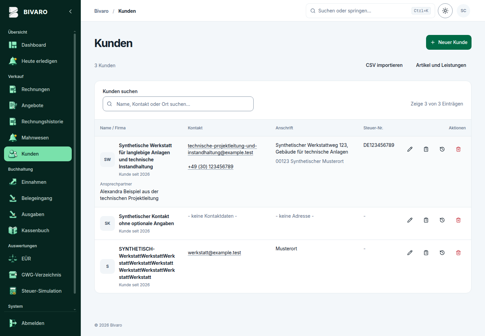
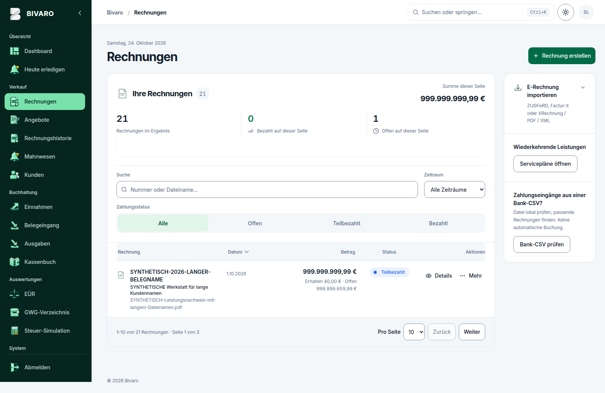
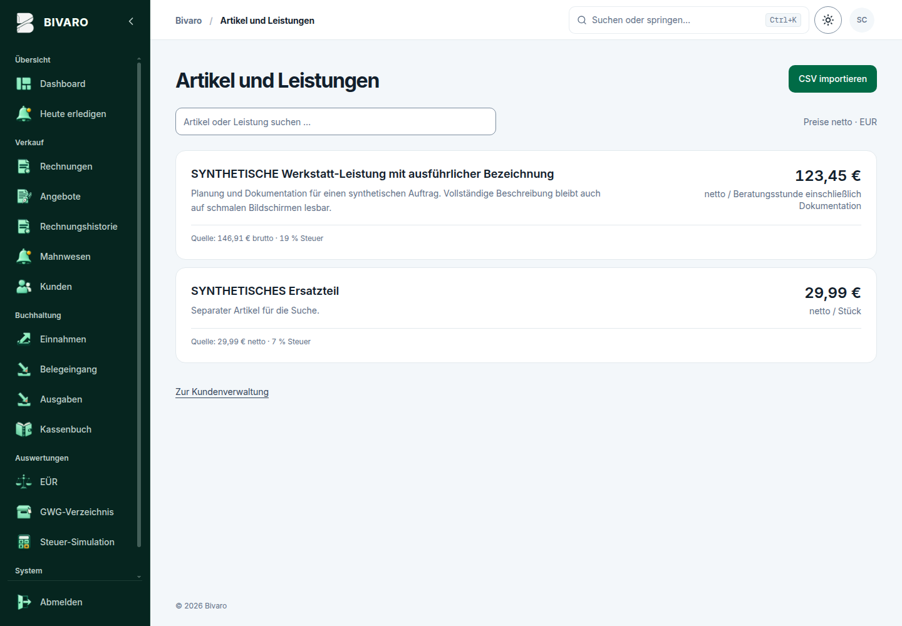
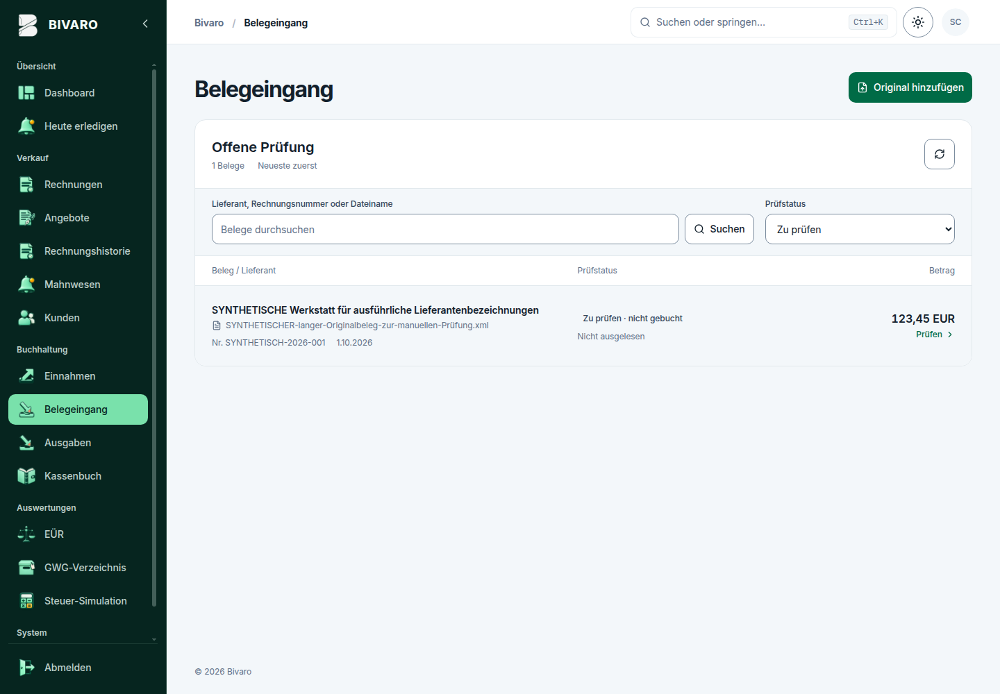

<div align="center">

# Bivaro

**Accounting and office workflows for freelancers and small businesses in Germany.**

Self-hosted · Quotes through receipt review · Light and dark mode

[Deutsch](README.md) · **English**

</div>

## Features

| Area | Current capabilities |
| --- | --- |
| **Overview** | Income, expenses, key figures, year comparisons and next steps for outstanding invoices, quotes and receipt reviews. |
| **Quotes & invoices** | Convert quotes to invoices, templates, payment terms, small-business and standard VAT modes. Own invoices include Factur-X/ZUGFeRD XML and final-file PDF/A-3b validation. |
| **Customers & services** | Customers and suppliers, customer history, article/service catalogue and reviewed customer/article CSV imports. Projects, manual time entries, service statements and confirmed recurring drafts. |
| **Payments & bank CSV** | Partial payments, outstanding balances and payment history. CSV preview with possible-duplicate warnings; explicitly record saved transactions as payments and change supported allocations. |
| **Receipts & expenses** | Archive originals, extract e-invoice data, resume review drafts and explicitly approve supported expenses. Source-linked expense details; optional AI suggestions. |
| **Reports** | Income/expense lists, cash book, low-value asset register, tax simulation, simplified EÜR CSV for 2024–2026 and neutral handoff packages. |
| **Email & integration** | Optional confirmed SMTP sending for invoices and quotes, attempt history, user roles and per-user API keys. |
| **Backups** | JSON and full ZIP backups with preview and version-bound restoration. |

## Screenshots

<table>
  <tr>
    <td width="50%" valign="top"><strong>Customers</strong><br><a href="docs/screenshots/customer-redesign-directory-light-1440.png"></a></td>
    <td width="50%" valign="top"><strong>Invoices</strong><br><a href="docs/screenshots/invoice-redesign-light-1600.png"></a></td>
  </tr>
  <tr>
    <td width="50%" valign="top"><strong>Income</strong><br><a href="docs/screenshots/cashflow-income-light-1440.png"></a></td>
    <td width="50%" valign="top"><strong>Expenses · dark mode</strong><br><a href="docs/screenshots/cashflow-expense-dark-1440.png"></a></td>
  </tr>
  <tr>
    <td width="50%" valign="top"><strong>Service catalogue</strong><br><a href="docs/screenshots/catalog-inbox-articles-light-1440.png"></a></td>
    <td width="50%" valign="top"><strong>Receipt inbox</strong><br><a href="docs/screenshots/catalog-inbox-receipts-light-1440.png"></a></td>
  </tr>
</table>

Actual German-language UI with synthetic test data. Click an image for the complete original. [Image provenance and review boundaries](docs/screenshots/README.md).

## Quick start

Requires Docker Engine with the Compose plugin and Git.

```bash
git clone https://github.com/storminator89/bivaro-kleinunternehmen.git
cd bivaro-kleinunternehmen
cp .env.example .env
```

Set **your own values** in `.env`: `NEXTAUTH_SECRET` (e.g. `openssl rand -base64 32`), `BIVARO_SETUP_TOKEN` (e.g. `openssl rand -hex 32`) and `NEXTAUTH_URL` (locally `http://localhost:3000`, or the exact public HTTPS URL).

```bash
docker compose config --quiet
docker compose up -d --build
```

Open `http://localhost:3000/register` and create the first admin account using the setup token. Then review company details, tax profile and bank details. Further registration requires explicit admin approval.

**Existing installation:** back up the database and uploads; stop all database writers before migrations. Use one app instance per SQLite database. `docker compose down -v` deletes data. [Setup, updates, backups, SMTP/AI and development](docs/operations/getting-started.en.md).

## Essential limitations

- **No tax or compliance certification:** technical PDF/XML validation is not business approval; no ELSTER filing.
- **No banking automation:** no bank connection, transfers or automatic reconciliation. Saving CSV evidence does not record payments or archive the raw file. Payment capture/reallocation supports bounded EUR small-business cases; corrections can block reports. [Payment rules](docs/features/bank-payment-allocation.md).
- **Explicit approval:** no automatic service billing, payments or retries of unknown email outcomes. SMTP acceptance is not proof of delivery.
- **Optional AI:** off by default, with explicit provider consent and possible costs/privacy obligations. Suggestions remain unreviewed; PDFs are limited to 6 MiB and 1–4 complete pages. [AI contract](docs/ai/provider-contract.md).
- **Operate securely:** use HTTPS publicly and keep secrets private. Use full ZIP backups for original files; back up server secrets and provider credentials separately. No built-in email password reset or self-service MFA. [Account access](docs/operations/account-access.md).

## License

The application is licensed under **[Apache License 2.0](LICENSE) (`Apache-2.0`)**. Third-party components and fonts retain their own licenses; this is not blanket license clearance for the container. [Third-party notices](docs/operations/pdf-third-party-notices.md) · [License details](docs/legal/application-license-transition.md).
