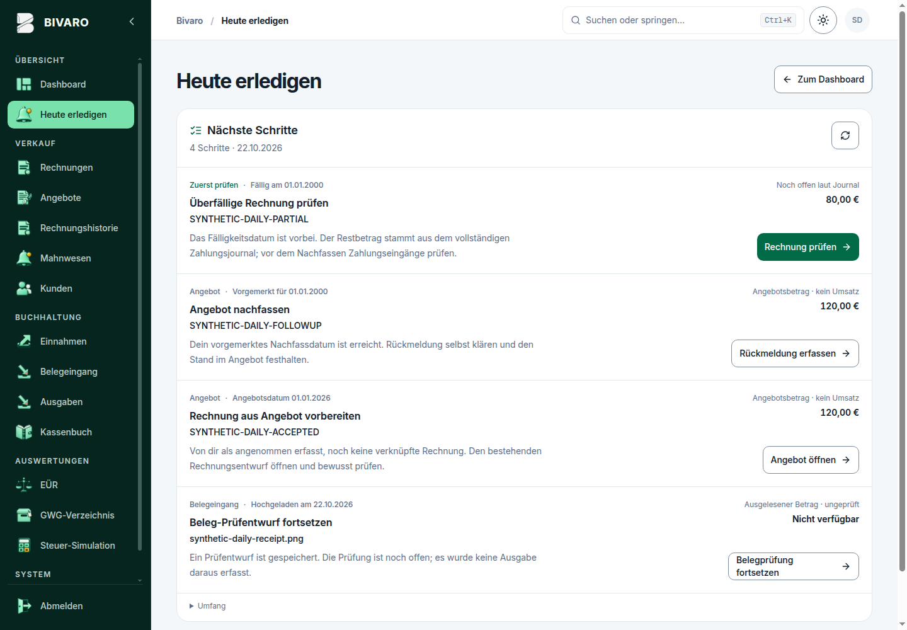
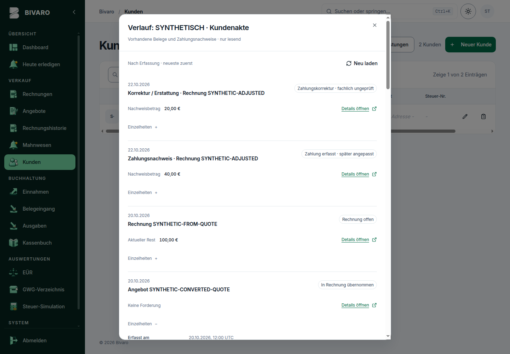
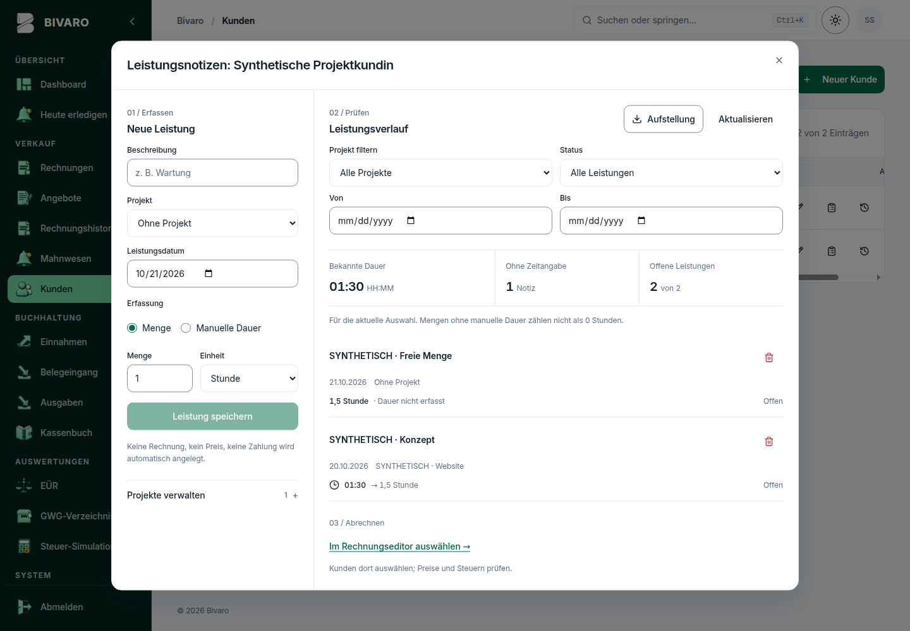
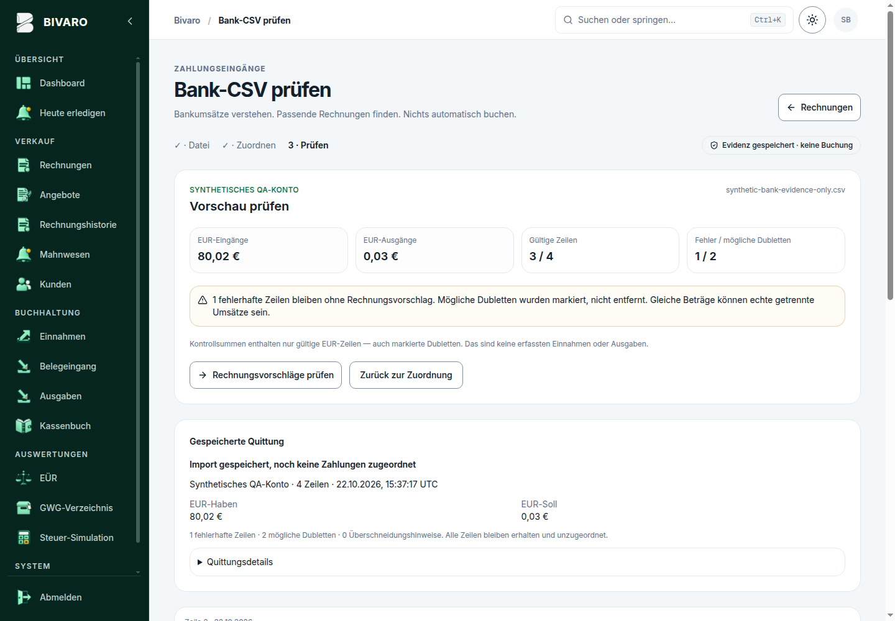
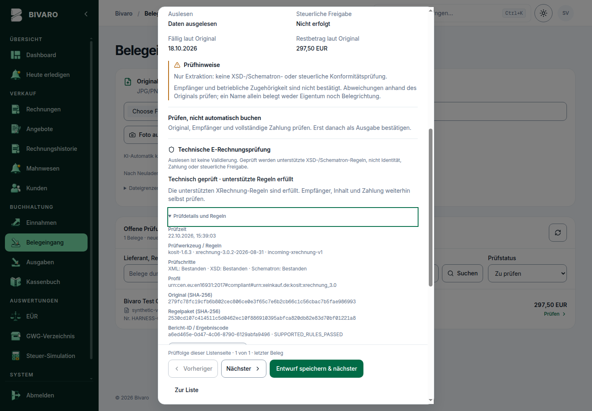
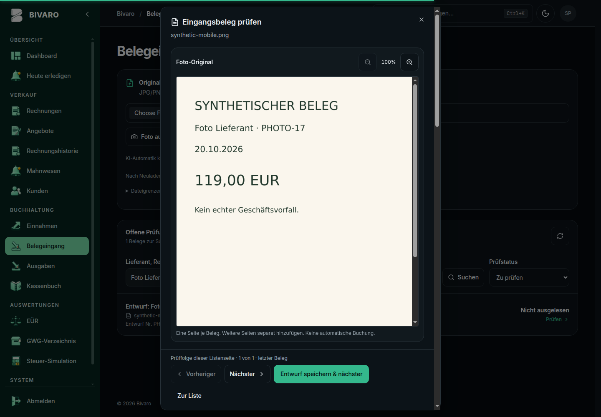
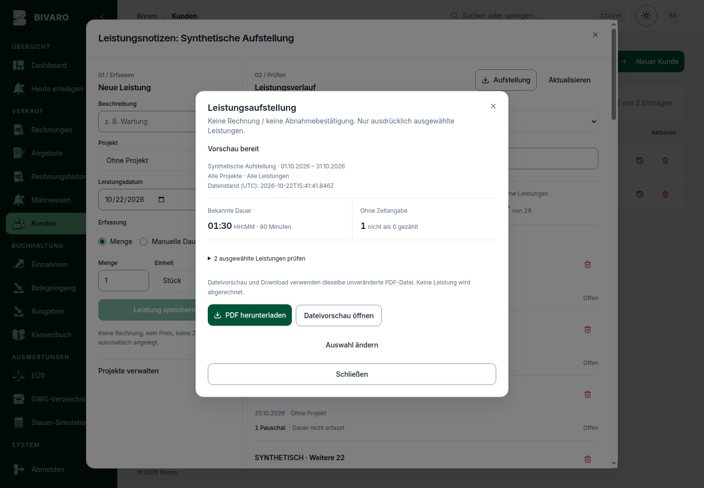

<div align="center">

# Bivaro

### Vom Angebot bis zum geprüften Beleg.

Buchhaltung und Büroalltag für Selbstständige und kleine Unternehmen in Deutschland.<br>
Selbst gehostet · Nachvollziehbare Belege · Bewusste Freigaben

**Deutsch** · [English](README.en.md)

[Funktionen](#funktionen) · [Einblicke](#einblicke) · [Installation](#installation) · [Betrieb](#betrieb-und-updates) · [Grenzen](#aktuelle-grenzen)

</div>

---

Bivaro verbindet Angebote, Rechnungen, Kunden, Leistungen, Zahlungen und Eingangsbelege in einem Web-Workspace. Statt stiller Automatik zeigt die Anwendung, was belegt ist, was noch geprüft werden muss und welcher Schritt eine ausdrückliche Bestätigung braucht. Ein Schwerpunkt liegt auf kleinen Unternehmen und der Kleinunternehmerregelung; der Rechnungseditor bietet auch einen Standard-Umsatzsteuermodus.

> **Aktueller Stand:** aktive Weiterentwicklung, keine pauschale GoBD-, Steuer- oder Compliance-Zertifizierung. Auslesen ist keine Freigabe, ein Bankimport ist keine Buchung und eine SMTP-Annahme ist kein Zustellnachweis. [Grenzen vor dem produktiven Einsatz lesen.](#aktuelle-grenzen)

<a href="docs/screenshots/daily-actions-1440.png"></a>

*„Heute erledigen“ führt zu offenen Rechnungen, Angebotsnachfassern und gespeicherten Belegprüfungen. Alle Abbildungen zeigen synthetische Testdaten.*

## Funktionen

| Arbeitsbereich | Was heute möglich ist |
| --- | --- |
| **Überblick & nächste Schritte** | Einnahmen-/Ausgabenübersicht, operative Kennzahlen, Jahresvergleich und eine Aufgabenansicht für überfällige Rechnungen, Angebote und offene Belegprüfungen. Optionaler Jahreskontext trennt eigene Angaben von tatsächlich erfassten Bewegungen. |
| **Angebote & Rechnungen** | Angebote mit Nachfassstatus, bewusste Übernahme in eine Rechnung, Vorlagen, Leistungskatalog, Logo und optionaler GiroCode. Zahlungsziel-Vorschläge folgen Kunde → Firma → 14 Tage; manuell gesetzte Daten bleiben geschützt. Eigene Rechnungen entstehen serverseitig mit eingebettetem Factur-X-/ZUGFeRD-XML und abschließender Prüfung der tatsächlichen PDF/A-3b-Datei. |
| **Kunden & Suche** | Kunden- und Lieferantenverwaltung, interne Kundenhinweise sowie ein lesender Kundenverlauf mit verknüpften Angeboten, Belegen und Zahlungsnachweisen. Strg/⌘+K sucht begrenzt in eigenen Kundennamen, Ausgangsbelegnummern und Eingangsbelegnummern/-dateinamen. |
| **Projekte & Leistungen** | Kundenbezogene Projekte, Mengennotizen und manuell erfasste Zeiten in `HH:MM`. Offene Leistungen bewusst im Rechnungseditor auswählen; Preise dort prüfen. PDF-Leistungsaufstellungen für ausdrücklich ausgewählte Leistungen. Wiederkehrende Servicepläne bereiten bestätigte Perioden als Entwürfe vor, nicht als automatische Abrechnung. |
| **Zahlungen & Historie** | Voll- und Teilzahlungen mit Zahlungsjournal und Restbetrag; getrennte Nachweise für Korrekturen und tatsächlich ausgeführte Erstattungen in unterstützten Fällen. Rechnungshistorie, referenzierte Vollstornos und kontrollierte Mahnwege statt Überschreiben der Originalhistorie. |
| **Belegeingang & Ausgaben** | Originale archivieren, XML oder eingebettete E-Rechnungsdaten auslesen, Lieferanten zuordnen und Prüfentwürfe fortsetzen. Foto-/Bildbelege lassen sich manuell prüfen. Listenweise Belegprüfung mit Speichern/Weiter und Schutz ungespeicherter Änderungen. Unterstützte XRechnung-XMLs erhalten eine separate technische XSD-/Schematron-Prüfung. Erst die ausdrückliche fachliche Bestätigung erzeugt eine unterstützte Ausgabe. |
| **Optionale KI-Erfassung** | Eigene OpenAI-kompatible Vision-Anbindung mit getrennten Freigaben für Anbieter und automatische neue Uploads. KI liefert ungeprüfte Vorschläge für geeignete Bilder/PDFs; keine Zahlung, Lieferantenauswahl oder automatische Buchung. Der manuelle Weg bleibt nutzbar. |
| **Bank-CSV & Datenübernahme** | UTF-8-CSV mit eigener Spaltenzuordnung, EUR-Kontrollsummen, Zeilenfehlern, Dublettenhinweisen und lesenden Rechnungsvorschlägen. Geprüfte Bankzeilen können als unzugeordnete Evidenz gespeichert und wieder geöffnet werden. Separate Vorschau-/Bestätigungsimporte für Kunden und Leistungskatalog. |
| **Auswertungen & Übergabe** | Einnahmen, Ausgaben, Kassenbuch, GWG-Verzeichnis und Steuersimulation. Vereinfachtes EÜR-CSV-Arbeitspapier für unterstützte Jahre 2024–2026; neutrale Übergabepakete mit Originalbezügen, Manifesten und Prüfhinweisen. Kein ELSTER-Versand. |
| **Einstellungen & Integration** | Benutzerrollen, API-Schlüssel, optionaler SMTP-Versand und bestätigter Rechnungs-/Angebotsversand mit dauerhaftem Versuchsjournal. JSON-/vollständige ZIP-Backups mit Vorschau und versionsgebundener Wiederherstellung. |

## Einblicke

Echte UI-Aufnahmen, keine Mockups. Auf ein Bild klicken, um das unveränderte Original zu öffnen. Die Oberfläche der gezeigten Version ist deutsch; helle und dunkle Ansichten gehören zur Anwendung.

<table>
  <tr>
    <td width="50%"><strong>Kundenverlauf</strong><br><a href="docs/screenshots/customer-timeline-desktop-1440.png"></a><br><sub>Belege und Zahlungsnachweise gemeinsam lesen, ohne einen Kundengesamtsaldo zu erfinden.</sub></td>
    <td width="50%"><strong>Projekte & Leistungszeiten</strong><br><a href="docs/screenshots/project-services-workbench-desktop-1440.png"></a><br><sub>Bekannte Dauer, Mengen und fehlende Zeitangaben bleiben unterscheidbar.</sub></td>
  </tr>
  <tr>
    <td width="50%"><strong>Bank-CSV mit Prüfquittung</strong><br><a href="docs/screenshots/bank-evidence-saved-1440.png"></a><br><sub>Kontrollsummen und mögliche Dubletten prüfen. Speichern bucht keine Zahlung.</sub></td>
    <td width="50%"><strong>Technische E-Rechnungsprüfung</strong><br><a href="docs/screenshots/incoming-validation-desktop-1440.png"></a><br><sub>Technische Regeln, Originalbezug und menschliche Freigabe sind getrennte Aussagen.</sub></td>
  </tr>
  <tr>
    <td width="50%"><strong>Original im Mittelpunkt</strong><br><a href="docs/screenshots/receipt-draft-desktop.png"></a><br><sub>Foto-Original ansehen, Prüfentwurf sichern und gezielt weiterarbeiten.</sub></td>
    <td width="50%"><strong>Leistungsaufstellung als PDF</strong><br><a href="docs/screenshots/service-statement-preview-1440.png"></a><br><sub>Bewusst ausgewählte Leistungen zusammenstellen. Keine Rechnung oder Abnahmebestätigung.</sub></td>
  </tr>
</table>

[Herkunft, Bildhashes und Prüfgrenzen aller sieben Screenshots](docs/screenshots/README.md)

## Aktuelle Grenzen

- **Keine Rechts- oder Steuerfreigabe:** gespeicherte Steuerprofile und Jahresangaben sind Selbstauskünfte. Umsatzindikatoren und Simulationen ersetzen keine individuelle Prüfung. Technische PDF-/XML-Prüfung bestätigt weder Identität noch Zahlung, Belegberechtigung oder die vollständige steuerliche Richtigkeit.
- **Kein Bankzugang:** kein Bankfeed, keine Überweisung, keine automatische Abstimmung oder Zahlungszuordnung. Bank-CSV-Evidenz enthält normalisierte Zeilen und Hashes, **nicht die archivierte Rohdatei**. Rechnungsvorschläge vergleichen höchstens die letzten 100 Rechnungen. [Details](docs/features/bank-import-evidence.md)
- **Korrekturen bewusst begrenzt:** Zahlungsanpassungen unterstützen bestimmte ausgestellte EUR-Kleinunternehmerrechnungen ohne Kassenverknüpfung. Bei vorhandener Anpassungshistorie sperren mehrere fiskalische Auswertungen/Exporte bis zur gesonderten Zuordnung; frische Mahnungen zu angepassten Rechnungen werden nicht unterstützt. Eine Stornierung erstattet kein Geld. [Vertrag](lib/payment-journal/README.md)
- **Keine unsichtbare Automatik:** kein laufender Leistungstimer, keine automatische Serviceabrechnung und kein geplanter Mahn- oder E-Mail-Worker. Bestätigte Restbetragsmahnungen bleiben ein kontrollierter manueller Weg; ihr SMTP-Versand ist nicht freigegeben. SMTP-Annahme beweist keine Zustellung, unbekannte Versandresultate verlangen eine bewusste Wiederholung.
- **KI ist optional und fehlbar:** Anbieter/Modell und Vision-Unterstützung sind nicht universell kompatibel oder zertifiziert. Datenübertragung kann Kosten und Datenschutzpflichten auslösen. Aktuell höchstens vier vollständige PDF-Seiten; ohne passende Konfiguration/Einwilligung keine KI-Anfrage. Vorschläge bleiben ungeprüft und dürfen keinen Zahlungszeitpunkt erfinden. [Grenzen und Einwilligung](docs/ai/receipt-extraction.md)
- **Betrieb ist Teil der Verantwortung:** SQLite ist für eine einzelne App-Instanz mit einem Datenbankziel vorgesehen, nicht für parallele Schreiber oder Hochverfügbarkeit. Kein eingebauter E-Mail-Passwortreset oder MFA-Self-Service. Öffentliche Hilfe-/Angebotsseiten sind kein zugesagter Support- oder Hostingvertrag. [Zugangshilfe](docs/operations/account-access.md)

## Installation

### Docker Compose

Der mitgelieferte Linux-Container bündelt die nativen PDF-/Prüfwerkzeuge. Docker Engine mit Compose-Plugin und Git werden vorausgesetzt; ein öffentlich erreichbarer Betrieb benötigt zusätzlich korrekt eingerichtetes HTTPS.

```bash
git clone https://github.com/storminator89/bivaro-kleinunternehmen.git
cd bivaro-kleinunternehmen
cp .env.example .env
```

**Vor dem Start `.env` bearbeiten:**

| Einstellung | Zweck |
| --- | --- |
| `NEXTAUTH_SECRET` | Eigenes langes Zufallsgeheimnis, z. B. mit `openssl rand -base64 32` erzeugen. Platzhalter ersetzen; sicher aufbewahren. |
| `NEXTAUTH_URL` | Exakter Browser-Ursprung, lokal `http://localhost:3000`, öffentlich die eigene HTTPS-URL. |
| `BIVARO_SETUP_TOKEN` | Eigenen einmaligen Bootstrap-Nachweis ergänzen, z. B. mit `openssl rand -hex 32` erzeugen. Nicht veröffentlichen. |
| `PORT` | Optionaler Host-Port, Standard `3000`. Compose setzt `DATABASE_URL` im Container auf `file:/app/data/prod.db`. |

```bash
docker compose config --quiet
docker compose up -d --build
docker compose logs --tail=100 buchhaltung
```

`/register` erstellt das erste Admin-Konto nur mit dem serverseitig konfigurierten Setup-Token. Ohne Token bleibt der Erststart geschlossen. Nach erfolgreichem Bootstrap wird dessen Verbrauch dauerhaft markiert; spätere Kontolöschung öffnet ihn nicht erneut. Weitere Registrierung muss ein Admin ausdrücklich freigeben. Danach Firmendaten, erklärtes Steuerprofil, Bankverbindung und gewünschte Vorlagen prüfen.

Alternativ enthält [`docker-compose.hub.yml`](docker-compose.hub.yml) die Registry-Variante. Deren Service heißt **`bivaro`**, während die Build-Variante **`buchhaltung`** verwendet. Dateien, Projektnamen und Volumes nicht unbesehen wechseln; ein anderer Compose-Kontext kann eine leere Installation statt der bestehenden Daten zeigen. Für kontrollierte Releases den gewünschten Image-Tag/Digest ausdrücklich auswählen, nicht `latest` als unveränderliche Version behandeln.

### Entwicklung aus dem Quellcode

Unterstützte Node-Versionen laut [`package.json`](package.json): **`>=22.23.4 <23` oder `>=24.22.1 <25`**. Das Dockerfile verwendet Node `22.23.4`. npm und Git werden benötigt.

Nach Klonen und Kopieren der `.env.example`:

1. Ein eigenes Datenverzeichnis anlegen (`mkdir -p data`) und in `.env` einen **absoluten** SQLite-Pfad setzen, etwa `DATABASE_URL="file:/absoluter/pfad/bivaro-kleinunternehmen/data/dev.db"`. Den Beispielpfad durch den tatsächlichen Pfad ersetzen. Relative SQLite-Pfade werden von Prisma relativ zum Schema ausgewertet; sie sind kein verlässlicher Standalone-/Containerpfad.
2. Secrets, Setup-Token und lokale `NEXTAUTH_URL` wie oben setzen.
3. Nur für diese neue Entwicklungsdatenbank ausführen:

```bash
npm ci
npm run db:generate
npm run db:migrate
npm run dev
```

Die UI läuft unter `http://localhost:3000`. Web-App, eigene PDF-Erzeugung und KI-Anbindung sind Node.js-basiert. **`npm ci` allein installiert nicht alle Laufzeitwerkzeuge:** Java wird für **beide technischen Prüfpfade** benötigt: veraPDF prüft die endgültigen eigenen PDF/A-3b-Rechnungen; der KoSIT-Validator prüft unterstützte XRechnung-XMLs. Diese lokalen Prüflaufzeiten benötigen Linux, Java, `prlimit` und die jeweils gepinnten Validator-/Regel-Assets. Java übernimmt weder die PDF-Erzeugung noch die KI-Anfrage. Im aktuellen Stand benötigen Fremd-PDF-Normalisierung und KI-PDF-Rasterung außerdem Ghostscript. Der Docker-Build richtet diese Werkzeuge ein. Fehlende Werkzeuge werden nicht durch eine behauptete erfolgreiche Prüfung ersetzt. [PDF-Aufbau und Laufzeit](docs/testing/own-invoice-pdfa-reconstruction.md)

## Betrieb und Updates

### Daten sichern, dann aktualisieren

- Den gewünschten geprüften Release-/Commit-Stand bereitstellen; lokale Änderungen vorher sichern. **Eine App-Instanz je SQLite-Datenbank.** Vor Migrationen die bestehende App und alle weiteren DB-Schreiber stoppen. Genügend Platz für Sicherung und Testkopie einplanen.
- Build-Compose: `buchhaltung-data` enthält `/app/data` mit Datenbank, **neuen privaten Uploads** unter `data/uploads` und Upgrade-Sicherungen. `buchhaltung-uploads` hält `/app/public/uploads` nur für Legacy-Dateien. Bei der Hub-Variante heißen die logischen Volumes `bivaro-data`/`bivaro-uploads`; tatsächliche Namen hängen vom Compose-Projekt ab.
- Datenbank **und** Uploads getrennt vom laufenden Host sichern und die Wiederherstellung überprüfen. `docker compose down -v` löscht Volumes; nicht als Update- oder Fehlerbehebungsbefehl verwenden.

```bash
# Build-Variante; bestehende Compose-Dateien und Projektnamen beibehalten
docker compose stop buchhaltung
docker compose build buchhaltung
docker compose up -d buchhaltung
docker compose logs --tail=100 buchhaltung
```

Standardmäßig prüft `DATABASE_MIGRATION_MODE=auto` vor dem Webserver den Migrationsstand. Bei ausstehenden Migrationen sichert der Upgrade-Job die bestehende SQLite-Datenbank, testet an einer Kopie und migriert erst danach das konfigurierte Ziel. Neue Datenbanken werden aus versionierten Migrationen aufgebaut. Fehler oder ungeklärte Schemaabweichungen blockieren den Start statt einer destruktiven Reparatur. Sicherungen bleiben unter `/app/data/backups`.

Für getrennte Wartung `DATABASE_MIGRATION_MODE=manual` setzen und nach dem Stoppen ausdrücklich ausführen:

```bash
docker compose run --rm --no-deps buchhaltung node scripts/upgrade-database.mjs
# Nur nach erfolgreichem Upgrade:
docker compose up -d buchhaltung
```

In der Hub-Variante zuerst `docker compose -f docker-compose.hub.yml pull bivaro`, dann den Service stoppen und mit **derselben Datei** aktualisieren; auch bei `run`, `up` und `logs` `-f docker-compose.hub.yml` und `bivaro` verwenden. Für Produktion kann die Build-Variante um [`docker-compose.prod.yml`](docker-compose.prod.yml) ergänzt werden; diese Datei richtet HTTPS nicht automatisch ein. [Upgrade-, Prüf- und Rückfallgrenzen](docs/backlog/BV-001-002.md)

### SMTP und optionale KI

- SMTP ist optional: Admin-Einstellungen oder `SMTP_HOST`, `SMTP_PORT`, `SMTP_SECURE`, `SMTP_USER`, `SMTP_PASSWORD`, `EMAIL_FROM` in der Serverumgebung. Gespeicherte Admin-Einstellungen haben Vorrang. `SMTP_SECURE=false` verlangt STARTTLS, `true` implizites TLS; Klartext-Relays sind nicht unterstützt. Ohne Konfiguration bleibt die Vorschau, nicht der Versand.
- KI wird pro Benutzer in den Einstellungen mit eigenem Endpunkt, Modell und Schlüssel eingerichtet. Aktivierung und automatische Analyse **neuer** geeigneter Uploads sind getrennt; beide sind standardmäßig aus. Öffentliche Anbieter verwenden HTTPS. Private/HTTP-Endpunkte erfordern eine exakte betreiberseitige Freigabe (`BIVARO_AI_PRIVATE_BASE_URLS`), keine Umgehung der TLS-Prüfung. Betreiber müssen diese Variable bei Bedarf selbst ausdrücklich in die Containerumgebung durchreichen. [Anbietervertrag](docs/ai/provider-contract.md)
- SMTP-/KI-Schlüssel werden verschlüsselt mit einem aus `NEXTAUTH_SECRET` abgeleiteten Schlüssel gespeichert und sind nicht Teil der portablen Geschäftsbackups. Bei Secret-Wechsel müssen betroffene gespeicherte Zugangsdaten neu verbunden werden. Keine Geheimnisse, `.env`, Datenbanken oder unbereinigten Screenshots committen.

### Backup und Restore

Unter **Einstellungen → Backup** vor dem Import stets die Vorschau prüfen. JSON enthält Geschäftsdaten, aber keine eingebetteten Originaldateien; bei Eingangsbelegen ist für eine vollständige Wiederherstellung das **vollständige ZIP-Backup** erforderlich. Auch ein Geschäfts-ZIP ersetzt keine vollständige Betriebssicherung: Servergeheimnisse, SMTP-/KI-Konfiguration und das E-Mail-Versuchsjournal sind nicht portabel enthalten.

Zusammenführen und Überschreiben sind unterschiedliche, versionsgebundene Wege. Vorhandene unveränderliche Zahlungs-/Korrektur-/Freigabehistorien können Überschreiben verbieten; widersprüchliche Beziehungen brechen die Wiederherstellung ab. Nicht durch Löschen der Historie oder Umdeklarieren alter Backups umgehen. Ein Restore startet keine KI-Analyse, Zahlung oder E-Mail erneut. [Zahlungs-/Restore-Vertrag](lib/payment-journal/README.md) · [Outbox-Grenzen](docs/roadmap/durable-email-outbox-contract.md)

## Sicherheit

Bivaro verwendet bcrypt mit Kostenfaktor 12, serverseitige Sitzungs-/Besitzprüfungen, Benutzerrollen, Login-/Registrierungslimits, Herkunftsprüfung für schreibende Browser-Anfragen, CSP-Nonces und strukturierte Audit-Ereignisse. Neue private Uploads werden über authentifizierte Endpunkte ausgeliefert. Das ist technische Absicherung, kein Prüfsiegel und kein Ersatz für Betreiberprozesse.

Öffentliche Installationen ausschließlich über korrekt konfiguriertes HTTPS betreiben, `NEXTAUTH_URL` exakt setzen, Zugänge begrenzen und System-/Anwendungsabhängigkeiten aktuell halten. `TRUST_PROXY` nur bei tatsächlich vertrauenswürdig gesetzten und bereinigten Proxy-Headern aktivieren; bei Compose gegebenenfalls ausdrücklich durchreichen. Audit-Log und Dokumenthistorie sind anwendungsseitige Nachweise, kein unabhängiges unveränderliches Fremdarchiv. Ein Admin kann Benutzer verwalten; daraus folgt kein pauschaler Zugriff auf fremde Geschäftsdaten. Für Zugangshilfe die [dokumentierten Identitäts- und Freigabegrenzen](docs/operations/account-access.md) beachten.

## Entwicklung und Verifikation

Next.js 16 · React 19 · TypeScript · Tailwind CSS 4/shadcn · TanStack Query 5 · Prisma 6/SQLite · NextAuth 4. Eigene Rechnungen: PDFKit, fontkit und pdf-lib mit veraPDF-Endprüfung; die weiteren PDF-/Prüfpfade sind davon getrennt.

| Befehl | Zweck |
| --- | --- |
| `npm run dev` | Entwicklungsserver |
| `npm run lint` | ESLint, null Warnungen |
| `npx tsc --noEmit --incremental false` | Typprüfung |
| `npm run build` | Produktionsbuild und gebündelte Drittanbieterhinweise |
| `npm run start` | Gebauten Standalone-Server starten |
| `npm run db:generate` / `npm run db:migrate` | Prisma-Client / versionierte Migrationen; kein Ersatz für den Upgrade-Ablauf bestehender Installationen |
| `npm run audit:security` | Audit der Produktionsabhängigkeiten; kein dauerhaftes Sicherheitsversprechen |

Vor `npm run start` außerhalb Docker müssen `public` und `.next/static` nach `.next/standalone/public` bzw. `.next/standalone/.next/static` kopiert sein. `.env`/Prozessumgebung und absolute Datenbankziele müssen auch für den gestarteten Standalone-Prozess stimmen; `npm run start` führt keine Migrationen aus.

`npm run test` führt die Vitest-Suiten aus, `npm run test:e2e` die Playwright-End-to-End-Suiten mit isolierten temporären Datenbanken. Aufbau und zusätzliche Sicherheitsprüfungen sind in [`AGENTS.md`](AGENTS.md) und [Browser-Abnahme](docs/testing/browser-acceptance-ci.md) beschrieben. CI- und Browserergebnisse gelten nur für den jeweils getesteten Commit und die angegebenen Konfigurationen; eine vorhandene Testdatei ist kein Ausführungsnachweis. Die unten verlinkten Berichte sind historische, jeweils versionsgebundene Nachweise, keine Aussage, dass jede spätere Änderung erneut geprüft wurde. Screenshots belegen die gezeigte Oberfläche, nicht eine reale Bank-, KI- oder SMTP-Anbindung.

### API

`GET /api/openapi` liefert die Spezifikation, `GET /api/v1/docs` JSON-Dokumentation und `GET /api/health` den Gesundheitsstatus. Die externe API unter `/api/v1` verwendet benutzerspezifische Schlüssel aus den Einstellungen, etwa als `Authorization: Bearer <API_KEY>`; API-Funktionen und Geltungsbereiche sind in [`lib/api-documentation.ts`](lib/api-documentation.ts) beschrieben. Die internen Sitzungsendpunkte sind kein pauschal stabiler öffentlicher Integrationsvertrag.

### Weiterführend

- **Funktionsverträge:** [Bankvorschau (erste Stufe)](docs/features/bank-csv-preview.md), [aktuelle Bank-Evidenz](docs/features/bank-import-evidence.md), [KI-Anbieter](docs/ai/provider-contract.md), [KI-Belege](docs/ai/receipt-extraction.md), [Projekte/Zeiten](docs/roadmap/project-service-times-contract.md), [Zahlungsjournal](lib/payment-journal/README.md).
- **Versionierte Prüfberichte:** [Zahlungsziele](docs/testing/payment-terms.md), [Kundenverlauf](docs/testing/customer-timeline.md), [Datensatzsuche](docs/testing/record-search.md), [Belegnavigation](docs/testing/incoming-review-cross-navigation-2026-10-22.md), [eigene PDF/A-Rechnungen](docs/testing/own-invoice-pdfa-reconstruction.md), [älterer Testaudit](docs/testing/legacy-code-audit-2026-10-17.md).
- **Planung, nicht Lieferzusage:** [Backlog](docs/backlog/TICKETSTATUS.md), [Pilot-Readiness](docs/roadmap/pilot-readiness.md), [fachliche GoBD-/Rechtsprüfgrenzen](docs/backlog/PRUEFPLAN-GOBD-RECHT.md).
- **README-Nachvollziehbarkeit:** [Funktions-/Quellenzuordnung](docs/readme-source-map.md), [Bildprovenienz](docs/screenshots/provenance.json).

## Lizenz

Bivaro steht derzeit unter **GNU Affero General Public License v3.0 only (`AGPL-3.0-only`)**. Maßgeblich ist [`LICENSE`](LICENSE). Drittanbieterkomponenten und Schriftarten behalten ihre jeweiligen Lizenzen; die [PDF-Laufzeithinweise](docs/operations/pdf-third-party-notices.md) beschreiben den geprüften Umfang und offene Inventargrenzen. Daraus folgt keine vollständige Lizenzfreigabe des gesamten Containers.
