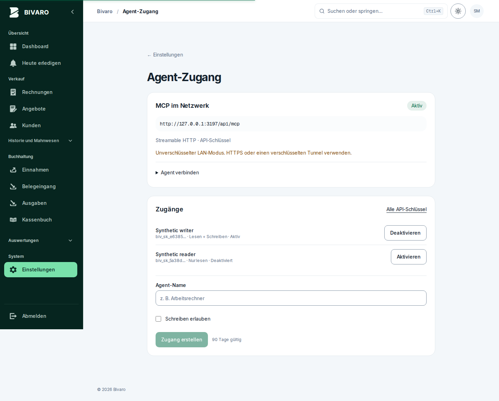

# Agent-Zugang über MCP

Bivaro enthält einen authentifizierten, zustandslosen Streamable-HTTP-Endpunkt unter
`/api/mcp`. Er verwendet das offizielle TypeScript-SDK 1.32.2 (unterstützte
Protokollstände einschließlich 2025-11-25). Es gibt keinen separaten Datenbankdienst,
keinen Internetzugang und keine Portfreigabe am Router. Die vorhandene App stellt
auch MCP bereit. Standardmäßig ist MCP deaktiviert; Schreibzugriff bleibt separat
standardmäßig gesperrt. Keine Schemaänderung oder Datenmigration erforderlich.

## Oberfläche

Geprüfte Testansichten mit synthetischen Zugängen; keine produktiven Schlüssel.

[Desktop](screenshots/2026-10-27/mcp-access-1440.png) · [Mobil](screenshots/2026-10-27/mcp-access-390.png)



## Im lokalen Netzwerk einrichten

Empfohlen: HTTPS über einen lokalen Reverse Proxy, beispielsweise Caddy mit interner
CA. Die CA muss auf Agent-Rechnern und gegebenenfalls im Node-Truststore vertraut
sein. TLS-Prüfungen nicht deaktivieren. Beispiel für eine lokal aufgelöste Adresse:

```caddy
bivaro.lan {
    tls internal
    reverse_proxy 192.168.0.126:7689
}
```

DNS/Hosts auf den Proxy zeigen lassen, dessen Port nur im LAN freigeben. HTTP-Port
7689 nach Möglichkeit nur für den Proxy erlauben. Für das MCP-Host-Checking muss
Caddy den ursprünglichen Host erhalten (Standard); Forwarded-Header ersetzen keine
Zugriffsprüfung. Ein rein lokales Zertifikat macht den Dienst nicht öffentlich.

In der Umgebung des **App-Containers** konfigurieren und den Container mit der
geänderten Umgebung neu erstellen:

```dotenv
BIVARO_MCP_ENABLED=1
BIVARO_MCP_URL=https://bivaro.lan/api/mcp
BIVARO_MCP_ALLOW_WRITES=0
```

Bei Compose müssen Variablen tatsächlich unter `environment` oder `env_file` an die
App durchgereicht werden. `.env` allein dient Compose nur der Interpolation. Vor der
Anwendung `docker compose config --quiet` ausführen; die aufgelöste Konfiguration
enthält Geheimnisse und darf nicht protokolliert werden.

Falls vorerst ausschließlich die bestehende private IPv4-HTTP-Adresse verwendet
werden kann, ist der Klartext-LAN-Modus explizit möglich:

```dotenv
BIVARO_MCP_ENABLED=1
BIVARO_MCP_URL=http://192.168.0.126:7689/api/mcp
BIVARO_MCP_ALLOW_INSECURE_LAN=1
BIVARO_MCP_ALLOW_WRITES=0
```

Dabei gehen Token und Geschäftsdaten unverschlüsselt durch das LAN. HTTPS oder ein
verschlüsselter Tunnel ist deshalb die passende dauerhafte Einrichtung. Öffentliche
HTTP-Adressen werden auch mit dieser Ausnahme abgewiesen. Host und vorhandener
Origin müssen exakt zur konfigurierten Adresse passen; kein CORS-Wildcard. Native
Agent-Clients ohne Origin sind zulässig. Nur im LAN erreichbare Dienste sind für
reine Cloud-Agents ohne eigene Netzwerkbrücke nicht erreichbar.

## Schlüssel erstellen und verwenden

1. In Bivaro **Einstellungen → Agent-Zugang** öffnen.
2. Agent benennen, **Schreiben erlauben** ausgeschaltet lassen, Zugang erstellen.
3. Den einmalig angezeigten Schlüssel im Secretstore des Agent-Clients speichern.
   Er gilt 90 Tage, ist nur gehasht gespeichert und kann sofort deaktiviert werden.
4. Als Streamable-HTTP-Server die angezeigte URL mit
   `Authorization: Bearer <Schlüssel>` eintragen. Der Server akzeptiert keine
   Schlüssel in URL-Parametern, Cookies oder Tool-Argumenten.

Hat der Client ein Feld **Header (KEY=VALUE)**, dort genau eine Zeile eintragen:

```text
Authorization=Bearer <MCP-Schlüssel>
```

Den Platzhalter durch den vollständigen Schlüssel ersetzen, ohne Anführungszeichen
und mit einem Leerzeichen nach `Bearer`. Anschließend **„Werkzeuge laden“** wählen:
ein Leseschlüssel bietet **5 Lesewerkzeuge**. **„Mit OAuth verbinden“** nur bei einem
bereits eingerichteten OAuth-Anbieter verwenden.

Beispiel für Clients mit JSON-MCP-Konfiguration (deren Format prüfen):

```json
{
  "mcpServers": {
    "bivaro": {
      "type": "http",
      "url": "https://bivaro.lan/api/mcp",
      "headers": { "Authorization": "Bearer <aus Secretstore>" }
    }
  }
}
```

Der TypeScript-SDK-Client kann direkt verbinden:

```js
import { Client } from '@modelcontextprotocol/sdk/client/index.js';
import { StreamableHTTPClientTransport } from '@modelcontextprotocol/sdk/client/streamableHttp.js';
const client = new Client({ name: 'local-agent', version: '1.0.0' });
await client.connect(new StreamableHTTPClientTransport(new URL(process.env.BIVARO_MCP_URL), {
  requestInit: { headers: { Authorization: `Bearer ${process.env.BIVARO_MCP_KEY}` } }
}));
const tools = await client.listTools();
const result = await client.callTool({ name: 'bivaro_read', arguments: { collection: 'customers', limit: 20 } });
await client.close();
```

Bestehende REST-Schlüssel mit `read`, `write` oder `*` erhalten keinen MCP-Zugriff.
Neue MCP-Schlüssel tragen ausschließlich `mcp:read` und optional `mcp:write`.
MCP-Rechte gewähren umgekehrt keine REST-Rechte. Benutzerdeaktivierung, Schlüssel-
Deaktivierung und Ablauf werden bei jeder HTTP-Anfrage erneut geprüft.

## Umfang und Grenzen

`bivaro_capabilities` und `bivaro://capabilities` liefern die vollständige, geschlossene
Sammlungsliste und genau die verfügbaren Felder. `bivaro_read` liefert maximal 50
Datensätze pro Seite; mit `id` einen einzelnen Datensatz, mit `search` die für diese
Sammlung unterstützte Textsuche. Seiten bis `hasMore=false` abfragen. Bei zu großen
Datensätzen kleinere Seiten bzw. eine einzelne ID verwenden. Nummernregeln besitzen
einen zusammengesetzten Schlüssel und werden über die Liste gelesen.

Enthalten sind Kontakte, Rechnungen/Angebote/Gutschriften mit geprüften Zahlständen,
Ein- und Ausgaben, Eingangsbelege, Projekte, Leistungsnotizen, Artikel, wiederkehrende
Ausgaben, Kassenbücher, Dokumentation, Vorlagen, Mahnnachweise, Zahlungsursprünge,
Berichtigungen, Bankimporte/-zeilen/-bindungen, Zuordnungshistorie, Abrechnungspläne
und Perioden, steuerlicher Jahreskontext, Nummernregeln, Versandnachweise und
manuelle Finanznachweise. `bivaro_settings` liefert das eigene Unternehmensprofil.
Die Datensätze sind nur innerhalb des angemeldeten Mandanten zugänglich.

`bivaro_payment_journal` liefert den geprüften aktuellen Vertragsstand 3 einschließlich
`ledgerVersion`, Herkunft und Datumsgewissheit. Historische Nachweise bleiben
historisch. Ursprungszahlungen, Einnahmen und Bankzeilen sind unterschiedliche
Sichten desselben Geldes: **nicht addieren**. Ein- und Ausgabenlisten bleiben bei
ungeklärter steuerlicher Abbildung von Zahlungsberichtigungen gesperrt. Das MCP
umgeht weder diese Sperre noch die vorhandenen Finanz- und Wiederherstellungsregeln.

`bivaro_original` liefert eigene Rechnungs-/Eingangsoriginale als Base64 in 128-KiB-
Blöcken, mit Dateigröße und SHA-256. `nextOffset` bis null verfolgen und den Hash des
zusammengesetzten Originals prüfen. Keine Dateipfade oder frei wählbaren URLs.
Betriebsgeheimnisse wie Benutzerpasswörter, API-Schlüssel, KI-/SMTP-Zugangsdaten,
Hostkonfiguration sowie Datenbank-/Backup-Dateien sind nicht lesbar.

## Schreiben bewusst zuschalten

Es sind **zwei Freigaben** erforderlich: am Server und für den einzelnen Zugang.
MCP muss bereits mit `BIVARO_MCP_ENABLED=1` und einer gültigen URL eingerichtet sein.

1. Serverbetreiber setzt `BIVARO_MCP_ALLOW_WRITES=1` in der wirksamen
   Container-Konfiguration. Die mitgelieferten Compose-Dateien übernehmen den Wert
   aus `.env`; bei einem fest eingetragenen Wert unter `environment` diesen direkt
   in der verwendeten Compose-Datei ändern.
2. Konfiguration prüfen und den App-Container **neu erstellen**. Ein bloßes
   `docker restart` oder `docker compose restart` übernimmt keine geänderten
   Umgebungsvariablen. Im Projektverzeichnis mit denselben Compose-Dateien und
   demselben Projektnamen wie beim bisherigen Start arbeiten.

   Für die Standard-Compose-Datei im Repository:

   ```bash
   docker compose config --quiet
   docker compose up -d --no-deps --force-recreate buchhaltung
   ```

   Für die Docker-Hub-Compose-Datei im Repository:

   ```bash
   docker compose -f docker-compose.hub.yml config --quiet
   docker compose -f docker-compose.hub.yml up -d --no-deps --force-recreate bivaro
   ```

   Bei eigenen Dateinamen oder einem zusätzlichen Produktions-Override die
   entsprechenden `-f`-Optionen beibehalten. Keine Volumes löschen.
3. Unter **Einstellungen → Agent-Zugang** einen **neuen** Zugang erstellen und
   **„Schreiben erlauben“** auswählen. Bereits ausgegebene Leseschlüssel werden
   dadurch nicht erweitert. Bleibt die Auswahl gesperrt, ist die Serverfreigabe
   noch nicht in der laufenden Container-Umgebung angekommen.
4. Nur diesem Agent den neuen Schlüssel geben. Im Client den bisherigen
   Bearer-Schlüssel ersetzen und **„Werkzeuge laden“** erneut anklicken. Es sollten
   **10 Werkzeuge: 5 zum Lesen und 5 zum Schreiben** erscheinen. In seinem Client
   Werkzeugfreigaben für tatsächliche Änderungen aktivieren; Tool-Annotationen
   ersetzen keine menschliche Zustimmung.

Bei OAuth ist kein neuer API-Schlüssel nötig: Zusätzlich zur Serverfreigabe muss
für das zugeordnete Subjekt `write: true` konfiguriert sein und das Access Token den
Scope `mcp:write` sowie `mcp:read` enthalten. Nach einer geänderten
Betreiberkonfiguration den Container neu erstellen, im Agenten die nötigen Scopes
neu autorisieren und die Werkzeuge neu laden. Die [OAuth-Einrichtung](#optional-vorhandenen-oauth-anbieter-anbinden)
beschreibt den vollständigen Tokenvertrag.

Der Server bietet dann fünf Schreibwerkzeuge:

| Werkzeug | Wirkung |
| --- | --- |
| `bivaro_customer_save` | Kunden anlegen/ändern; Änderung mit `_version` aus aktuellem Leseergebnis. Kontaktfelder werden vollständig ersetzt. |
| `bivaro_supplier_save` | Lieferanten anlegen/ändern; Änderung mit `expectedRevision`. |
| `bivaro_payment_record` | Tatsächlich bereits erhaltene Zahlung mit Datum, Referenz und stabilem Idempotenzschlüssel erfassen. |
| `bivaro_legacy_payment_adopt` | Bestehendes historisches PAID samt vorhandener Einnahme übernehmen; keine Datumserfindung, keine zweite Einnahme. |
| `bivaro_payment_adjustment` | Bestehenden Korrektur-/bereits erfolgten Erstattungsablauf verwenden; sämtliche Nachweis- und Steuersperren gelten weiter. |

Keine Lösch-, Restore-, Shell-, SQL-, Überweisungs- oder automatischen Versandtools.
Die übrigen App-Schreibabläufe sind bewusst noch nicht als MCP-Tools freigegeben.
Finanzwerkzeuge nutzen dieselben Fachfunktionen, Transaktionen, Audit-Nachweise und
Idempotenz wie die Anwendung. Gleiche Zahlung mit gleichem Schlüssel erneut senden,
nicht mit neuem Schlüssel. Kontakt-Neuanlagen sind **nicht idempotent**: Nach einer
unterbrochenen Antwort erst nach dem Kontakt suchen. Bestandsänderungen verlieren
bei zwischenzeitlichen Änderungen ihre Freigabe und müssen frisch gelesen werden.
Für rückwirkende Zahlungen keine Zeitpunkte oder Referenzen erraten.

`BIVARO_MCP_ALLOW_WRITES=0` entzieht sämtlichen Agent-Zugängen Schreibrechte, sobald
der App-Container mit dieser Umgebung neu erstellt wurde. Einzelne Zugänge in der Oberfläche deaktivieren. Neue Rechte werden
bei jeder HTTP-Anfrage ermittelt; es gibt keinen wiederverwendbaren Mandanten-
Sessionzustand. Werkzeugaufrufe werden mit Werkzeugname, Zugang und Ergebnis
protokolliert, ohne Token oder komplette Anfragen zu protokollieren.

## Optional: vorhandenen OAuth-Anbieter anbinden

Bivaro ist ein **OAuth Resource Server**, kein selbst gebauter Authorization Server.
Der vorhandene Anbieter übernimmt Login, Consent, Authorization Code mit PKCE S256,
Clientregistrierung und Tokenrotation. Der Anbieter und MCP müssen per HTTPS mit
auf den Agent-Rechnern vertrauter Zertifikatskette erreichbar sein.

```dotenv
BIVARO_MCP_OAUTH_ISSUER=https://auth.lan/application/o/bivaro/
BIVARO_MCP_OAUTH_JWKS_URL=https://auth.lan/application/o/bivaro/jwks/
BIVARO_MCP_OAUTH_CLIENT_IDS=bivaro-agents
BIVARO_MCP_OAUTH_SUBJECTS={"immutable-provider-sub":{"userId":"existing-bivaro-user-id","write":false}}
```

Beim Anbieter einen nativen/public Agent-Client mit exakten Redirect-URIs und
PKCE S256 konfigurieren. Access Tokens müssen signierte JWTs mit `typ=at+jwt`,
`iss` exakt wie konfiguriert, `aud` exakt gleich `BIVARO_MCP_URL`, `sub`, `iat`, `exp`,
`scope=mcp:read` und optional `mcp:write` enthalten. `client_id` oder `azp` muss in der
expliziten Clientliste stehen. Nur RS256, ES256 und EdDSA sind zulässig; Lebensdauer
höchstens 15 Minuten. Provider gegebenenfalls auf diesen JWT-Access-Token-Vertrag
konfigurieren. ID-Tokens und Tokens für andere APIs werden abgewiesen.

Bivaro veröffentlicht RFC-9728-Metadaten unter
`/.well-known/oauth-protected-resource/api/mcp`; ein HTTP-401 verweist per
`WWW-Authenticate` darauf. Der Authorization Server muss seine RFC-8414- oder OIDC-
Discovery anbieten. Es gibt keinen Token-Passthrough an andere APIs und keine
automatische Zuordnung über E-Mail oder vom Client angelieferte Benutzer-IDs.
Subjektzuordnung und maximale Schreibfreigabe legt ausschließlich der Betreiber
fest. Selbst ein Provider-Token mit mcp:write kann eine read-only Zuordnung nicht
erweitern. Private JWKS-Endpunkte sind absichtlich möglich; deren URL stammt nur
aus der Betreiberkonfiguration, nie aus einem eingehenden Token.

JWTs werden lokal anhand des Provider-JWKS validiert. Deaktivieren des Bivaro-
Benutzers sperrt sofort; Widerruf beim OAuth-Anbieter greift spätestens nach dem
Tokenablauf (maximal 15 Minuten), da keine Online-Introspektion stattfindet.
API-Schlüssel funktionieren parallel weiter; ohne OAuth-Konfiguration werden keine
OAuth-Metadaten oder Login-Endpunkte vorgetäuscht.

## Validierung

Gezielte Tests: `npm test -- lib/__tests__/mcp.test.ts lib/__tests__/mcp-auth.test.ts lib/__tests__/mcp-access-keys.test.ts`.
Sie verwenden ausschließlich frische temporäre SQLite-Fixtures, reale MCP-SDK-
Nachrichten sowie kryptographisch signierte synthetische OAuth-Tokens. Der Browser-
Test `e2e/mcp-access.spec.ts` läuft über
`BIVARO_E2E_PORT=3197 npm run test:e2e -- --config playwright.mcp.config.ts` mit der
isolierten Produktionskonfiguration, niemals auf einer bestehenden Installation.
Die normale Browserauswahl aktiviert ihn gezielt für MCP-Änderungen; die globale
Standardkonfiguration ohne MCP-Freigabe sammelt ihn nicht versehentlich ein.

Primärquellen: [MCP SDK](https://github.com/modelcontextprotocol/typescript-sdk),
[MCP-Autorisierung](https://modelcontextprotocol.io/specification/2025-11-25/basic/authorization).
