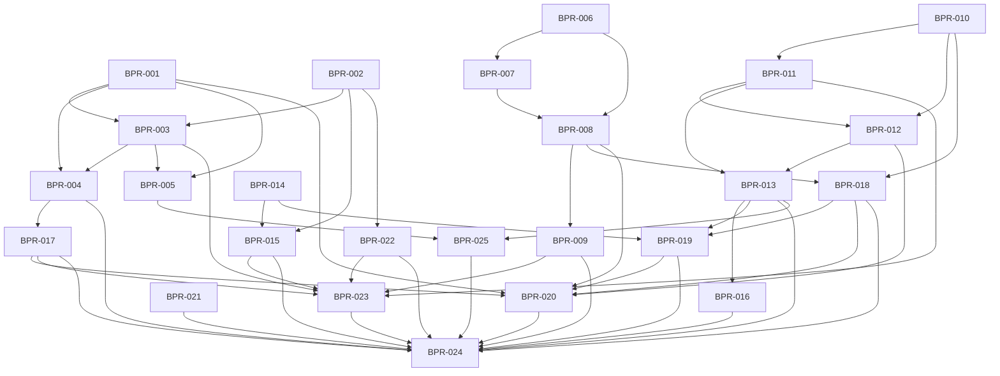

# Bivaro: konkrete Pilot-Readiness-Roadmap

> Stand 20.10.2026 · 25 kleine Lieferpakete · **Plan und Arbeitsstand, kein Abschluss- oder Produktivfreigabenachweis.**

## Ziel und Umfang

Firma/erklärter Steuerstatus → eigene Rechnung → tatsächliche Zahlung → fremder Beleg/Ausgabe → nachvollziehbare Korrektur → kontrollierte Übergabe → Wiederherstellung. Grundlage sind die vier Recherchen zu Markt, Käuferweg, technischer Produktreife und Anforderungen. Befund, Hypothese und noch fehlender Nachweis bleiben getrennt. SaaS, Selbstbetrieb und betreute Einzelinstanz sind offene Modelle; zuerst entstehen modellneutrale Grundlagen und klar synthetische Beispiele, keine erfundene Nachfrage.

Keine erfundenen Anbieter-/Preis-/Kontakt-/Hostingdaten, Siegel oder Compliancegarantien. Kein automatischer Checkout, Bankfeed, OCR, neues Authentifizierungsmodell oder Cloudanbieter als beiläufige Erweiterung. Software integriert ≠ Browser akzeptiert ≠ fachlich freigegeben ≠ für echten bezahlten Betrieb freigegeben.

## Kleiner erster Lieferumfang

- **BPR-001:** genau drei Settings-Felder: `fiscalTaxRegime`, `fiscalEffectiveFrom`, `fiscalConfirmedAt`; bestehendes `/api/settings` bleibt der Vertrag. Keine Gründung/Umsatz-/Revisions-/Historienautomatik im ersten Paket.
- **BPR-002:** ehrliche Public-/Help-UI parallel zum minimalen Backend.
- **BPR-003:** kleines bestehendes Settingspanel plus Checkliste aus tatsächlich gespeicherten Daten; kein neuer Pflichtwizard.
- **BPR-004:** datierte Defaults und bewusste Steuerentscheidung pro neuem Beleg, vorhandene Vorlagen/Angebote/Legacydaten erhalten.
- **BPR-014:** erster Export-Core unabhängig von zukünftigen Supplier-/Zahlungs-/Korrekturmodellen; spätere Add-ons und UI-/Browserabnahme bleiben ausdrücklich offen.
- Jahreskontext/Revisions-/Statushistorie erst **BPR-005**; Indikator-/Simulationdarstellung danach **BPR-025**. So erweitert sich der erste Scope nicht still.

## Wellen und Abhängigkeiten

Wellen sind Integrationsabschnitte, keine Kalenderzusagen. Ein Backend-Core kann unabhängig geprüft werden, ist ohne zugehörigen UI-/Browsernachweis aber kein vollständig abgenommener Nutzerablauf. S/M kennzeichnen relative Paketgröße, keine Zeitgarantie.

| Welle | Pakete | Ergebnis |
|---|---|---|
| 1 – Minimale Grundlagen | BPR-001, BPR-002, BPR-006, BPR-021 | Minimales Settingsprofil, ehrliche Hilfe, sicherer Eingangspfad. |
| 2 – Gespeicherter Erststart und unabhängiger Export-Core | BPR-003, BPR-004, BPR-007, BPR-010, BPR-014, BPR-022 | Profilpanel/Checkliste, datierte Dokumentdefaults und unabhängig prüfbarer Core-Export; keine zukünftigen Modelle vorwegnehmen. |
| 3 – Verbundene Beleg-/Zahlungsabläufe | BPR-005, BPR-008, BPR-009, BPR-011, BPR-017 | Optionale Profilvertiefung getrennt vom Erststart; Eingang→Ausgabe, Teilzahlungen und Belegkorrektur. |
| 4 – Korrekturen und konsistente Jahres-/Übergabedaten | BPR-012, BPR-013, BPR-016, BPR-018, BPR-025 | Refund/Korrektur, sichere Jahresgrenzen, klare Datenindikatoren; Core-Export um fertige Modelle erweitern. |
| 5 – Geführte Übergabe und Wiederherstellung | BPR-015, BPR-019, BPR-020, BPR-023 | Export-Add-ons/Browserabnahme, versionierter Stand und vollständiger Restore. |
| 6 – Begrenzte evidenzgebundene Freigabe | BPR-024 | Software-, Browser-, Fach- und Betriebsfreigabe getrennt belegen. |

### Ticketindex

| Ticket | Ergebnis | Abhängigkeiten | Status |
|---|---|---|---|
| [BPR-001](https://github.com/storminator89/bivaro-kleinunternehmen/issues/36) | Minimales dauerhaftes Steuerprofil in bestehenden Settings | — | browser_accepted_pending_owner_gate |
| [BPR-002](https://github.com/storminator89/bivaro-kleinunternehmen/issues/35) | Öffentliche Scope-/Aufgabenhilfe und konsistenter UI-Rahmen | — | browser_accepted_pending_owner_gate |
| [BPR-003](https://github.com/storminator89/bivaro-kleinunternehmen/issues/37) | Steuerprofil-Settingspanel und gespeicherte Erststart-Checkliste | BPR-001, BPR-002 | browser_accepted_pending_owner_gate |
| [BPR-004](https://github.com/storminator89/bivaro-kleinunternehmen/issues/38) | Datierte Profildefaults und bewusste Steuerwahl im Belegeditor | BPR-001, BPR-003 | browser_accepted_pending_owner_gate |
| [BPR-005](https://github.com/storminator89/bivaro-kleinunternehmen/issues/40) | Folgepaket: Jahreskontext und nachvollziehbare Steuerprofiländerungen | BPR-001, BPR-003 | planned |
| [BPR-006](https://github.com/storminator89/bivaro-kleinunternehmen/issues/39) | Sicherer Eingang: Originalarchiv und explizite Belegrichtung | — | in_progress |
| [BPR-007](https://github.com/storminator89/bivaro-kleinunternehmen/issues/41) | Lieferanten als eigener besitzergebundener Kontakt | BPR-006 | planned |
| [BPR-008](https://github.com/storminator89/bivaro-kleinunternehmen/issues/42) | Geprüfter Eingang wird genau einmal zur Ausgabe | BPR-006, BPR-007 | planned |
| [BPR-009](https://github.com/storminator89/bivaro-kleinunternehmen/issues/43) | Mobile Beleg-Inbox: finden, prüfen, fortsetzen | BPR-008 | in_progress |
| [BPR-010](https://github.com/storminator89/bivaro-kleinunternehmen/issues/44) | Zahlungsjournal als idempotente Quelle für Rechnungszahlungen | — | planned |
| [BPR-011](https://github.com/storminator89/bivaro-kleinunternehmen/issues/45) | Teilzahlungen und verständlicher Restbetrag | BPR-010 | in_progress |
| [BPR-012](https://github.com/storminator89/bivaro-kleinunternehmen/issues/46) | Zahlungsirrtum und Erstattung ohne Historienverlust | BPR-010, BPR-011 | planned |
| [BPR-013](https://github.com/storminator89/bivaro-kleinunternehmen/issues/47) | Restschuld in Mahnung, Dashboard und Zahlungs-Auswertungen | BPR-011, BPR-012 | planned |
| [BPR-014](https://github.com/storminator89/bivaro-kleinunternehmen/issues/48) | Unabhängiger Kernexport mit Manifest und späteren Fach-Add-ons | — | in_progress |
| [BPR-015](https://github.com/storminator89/bivaro-kleinunternehmen/issues/49) | Geführte Monats-/Jahresübergabe mit Kontrollseite | BPR-014, BPR-002 | in_progress |
| [BPR-016](https://github.com/storminator89/bivaro-kleinunternehmen/issues/50) | Steuerjahr-/Mappingversion explizit und sichere 2026-Grenze | BPR-013 | planned |
| [BPR-017](https://github.com/storminator89/bivaro-kleinunternehmen/issues/51) | Ausgestellte Rechnung: nachvollziehbare Korrektur und Historie | BPR-004 | planned |
| [BPR-018](https://github.com/storminator89/bivaro-kleinunternehmen/issues/54) | Manuelle Einnahmen/Ausgaben bewusst festschreiben und korrigieren | BPR-008, BPR-010 | planned |
| [BPR-019](https://github.com/storminator89/bivaro-kleinunternehmen/issues/52) | Periodensnapshot mit bewusstem Schließen und Wiederöffnen | BPR-014, BPR-018, BPR-013 | planned |
| [BPR-020](https://github.com/storminator89/bivaro-kleinunternehmen/issues/53) | Backupformat erweitern und vollständige Wiederherstellung beweisen | BPR-001, BPR-008, BPR-012, BPR-017, BPR-018, BPR-019 | planned |
| [BPR-021](https://github.com/storminator89/bivaro-kleinunternehmen/issues/55) | Erreichbare Hilfe bei Zugang verloren und Betriebsstörung | — | planned |
| [BPR-022](https://github.com/storminator89/bivaro-kleinunternehmen/issues/56) | Transparente Angebotskonfiguration ohne erfundene Verkaufstatsachen | BPR-002 | planned |
| [BPR-023](https://github.com/storminator89/bivaro-kleinunternehmen/issues/57) | Modellneutrale sichere Demo und begleiteter Umstiegsplan | BPR-003, BPR-009, BPR-011, BPR-015, BPR-017, BPR-022 | planned |
| [BPR-024](https://github.com/storminator89/bivaro-kleinunternehmen/issues/58) | Versionsgebundene Releaseabnahme und Betreiber-/Recoverynachweis | BPR-004, BPR-009, BPR-013, BPR-015, BPR-016, BPR-017, BPR-018, BPR-019, BPR-020, BPR-021, BPR-022, BPR-023, BPR-025 | planned |
| [BPR-025](https://github.com/storminator89/bivaro-kleinunternehmen/issues/59) | Datenbegrenzte Umsatzindikatoren und verständliche Steuersimulation | BPR-005, BPR-013 | planned |

BPR-014-Add-ons besitzen zusätzlich eigene Abhängigkeiten: Eingang BPR-008, Zahlungs-/Refunddaten BPR-012 und Korrekturbezüge BPR-017/018. Der Core hat diese Abhängigkeiten bewusst nicht; sein Status darf nicht als vollständiger zukünftiger Export interpretiert werden.

## UI-/UX- und Browservertrag

Premium heißt klare, ruhige Typografie, konsistente Flächen/Abstände/Design-Tokens, lesbare Beträge, eine klare Hauptaktion und verständliche Grenzen. Keine dekorative Landingpage neben einem unverständlichen Arbeitsablauf. Vorhandene Designleitlinien und UI-Komponenten weiterverwenden; Fachfelder progressiv zeigen statt den Erststart zu überladen.

Jeder betroffene Ablauf wird am exakt bezeichneten Kandidatenbuild mit synthetischen Daten geprüft: Happy Path, Fehler/Retry, Zurück/Abbrechen, Reload/zweiter Tab, Mobilansicht und vollständige Tastaturbedienung. Zusätzlich 360/390/768/1440px, sichtbarer Fokus, Modal-Fokusrückkehr, Labels, feldnahe Fehler und lesbare Leer-/Lade-/Erfolgszustände. Screenshots ergänzen beobachtete Ergebnisse, ersetzen sie nicht.

## GLOBAL-DOD

1. Issue nennt Story, Scope/Nichtziele, Abhängigkeiten und Owner; PR/Commit/CI/Browser-Evidenz werden erst nach tatsächlicher Ausführung verlinkt.
2. Kleiner fachlicher Slice ohne sachfremde Änderungen. Bestehende Daten-/Dokumente und Besitzgrenzen bleiben erhalten; DTO-, Migrations-, Backup- und Exportfolgen dokumentieren.
3. Build/Lint und passende gezielte Unit-/Integrationsfälle mit exaktem Commit und Ergebnis; gemeinsame Regressionen nach Integration prüfen. Datenexperimente ausschließlich in frischem explizitem Fixtureziel, nicht in Repository-/Produktivdaten.
4. Browserabnahme gegen exakten Kandidaten: Happy Path, Fehler/Retry, Zurück/Abbrechen, Reload/zweiter Tab, mobil und Tastatur. Beobachtete Ergebnisse/Screenshots dokumentieren; Backend ohne integrierte UI bleibt teilgeliefert.
5. Ein- und Ausgang, Originalbezug, Centbeträge/Rundung, Zahlungsdatum, Status, Historie und Summen/Export soweit betroffen konsistent; kein Doppelumsatz oder stiller Verlust.
6. Konsistente Design-Tokens/Typografie/Abstände und hochwertige Erst-/Leer-/Lade-/Fehler-/Erfolgszustände. 360/390/768/1440px, klarer Fokus, verständliche Labels und direkte Rückwege.
7. CI gehört zum tatsächlichen PR-Commit; fehlende Evidenz ist Restarbeit. Merge-/Buildartefakt ist kein Nachweis eines laufenden Produktivdiensts.
8. Fach-/UI-Review, bekannte Grenzen und gegebenenfalls externe Gates explizit. Software integriert, Browser akzeptiert und echter Pilot freigegeben sind unterschiedliche Zustände.
9. Keine erfundenen Anbieter-/Preis-/Kontakt-/Hosting-/Nachfrage-/Complianceangaben. Keine neuen Provider-, Zahlungs- oder Authentifizierungsintegrationen als Nebenwirkung dieses Plans.

## Externe und betriebliche Nachweise

Offene Fakten halten nur davon abhängige echte Verkaufs-/Betriebsfreigaben auf, nicht unabhängige Softwaregrundlagen. Technische Fixture-Restore-Evidenz ist Engineeringarbeit; reale Betreiber-, Rechts-, Preis- und Kontaktangaben kann Code nicht erfinden.

| Gate | Aktion / Ziel | Grund | Fertig-Nachweis |
|---|---|---|---|
| G-FISCAL | Unterstützte Fachfälle und versionierte Soll-Ergebnisse durch fachkundige Person bestätigen — Beworbene Rechnungs-/Zahlungs-/Korrekturfälle; erweiterter Jahreskontext erst BPR-005 | Software darf keine unbekannte steuerliche Einstufung als Gewissheit verkaufen. | Benannter Reviewer, Scope und signiertes/ausdrücklich bestätigtes Abnahmeprotokoll mit Releasebezug. |
| G-MODEL | Pilotsegment und tatsächlich lieferbare Betriebsvariante festlegen; Zahlungsbereitschaft getrennt validieren — Owner-Entscheidung vor verbindlichem Pilotangebot | SaaS, Selbstbetrieb und betreute Instanz sind offene Modelle; Code ist kein Nachfragebeleg. | Klare Unterstützt-/Nicht-unterstützt-Matrix, Verantwortung und belegtes Angebot; echte Nachfrage nur aus autorisierten Pilotbelegen. |
| G-OFFER | Tatsächliche Anbieter-, Kontakt-, Preis-, Laufzeit-, Steuerdarstellungs-, Support- und Exitdaten liefern — Öffentliche Angebotskonfiguration BPR-022 | Keine kommerziellen Fakten erfinden oder still Standardwerte als Angebot ausgeben. | Owner-bestätigte vollständige Konfigurationsrevision; vorher nur technische Grundlage/Konzept. |
| G-LEGAL | Konkretes Angebots-/Betriebsmodell fachrechtlich prüfen lassen — Erforderliche Anbieter-/Datenschutz-/Vertrags-/Lizenzunterlagen und fachliche Herstellerfreigabe | Anwendbarkeit und Dokumente hängen vom tatsächlichen Modell ab; Roadmap ist keine Rechtsfreigabe. | Benannte Verantwortliche, erforderliche Unterlagen und Scopeentscheid, tatsächlicher ausgelieferter Source-/Lizenzstand. Keine pauschale Zertifizierung. |
| G-RETENTION | Datenklassen, Original-/Änderungshistorie, Exit und Lösch-/Aufbewahrungsverantwortung bestätigen — Korrektur-/Periodenmodell und bestehende Audit-/Backupprozesse | Technische Sperre oder Hash allein beweist keinen vollständigen Aufbewahrungsprozess. | Freigegebenes Verfahren mit nachvollziehbaren Beleg-/Änderungs-/Exitfällen; keine automatische Löschroutine aus Vermutung. |
| G-YEAR | Offizielle 2026-Formularquelle samt konkreten Zeilen fachlich verifizieren — Optionaler EÜR-2026-Mappingadapter | Recherche hat Veröffentlichung, nicht alle konkreten neuen Zeilen verifiziert. | Archivierte offizielle Version und referenzierte positive/negative Sollfälle; sicherer unsupported-Fallback unabhängig fertigstellbar. |
| G-HANDOFF | Vorgesehenes Paket mit zustimmendem fachkundigem Empfänger praktisch nachvollziehen — Kanzleipaket in BPR-014/015 | Ein CSV/ZIP allein beweist keine universelle DATEV- oder Kanzleikompatibilität. | Konkreter Empfänger, Zeitraum/Formatversion, Beleg-/Zahlungs-/Summenabgleich und dokumentiertes Ergebnis; Kontaktaufnahme separat autorisieren. |
| G-SUPPORT | Tatsächlichen Kontakt, Zuständigkeit und Identitätsprüfung benennen — Zugangshilfe/Incident-/Recoveryprozess | Eine Hilfe ohne erreichbaren Verantwortlichen schließt den Supportprozess nicht. | Verifizierter Kontakt und freigegebenes Runbook; kein neuer Authprovider erforderlich. |
| G-RESTORE | Synthetischen Restore in frischem getrenntem Ziel durchführen; tatsächlichen Betriebsdrill separat nachweisen — BPR-020 technische Wiederherstellung; BPR-024 Betriebsnachweis | Produktive Daten dürfen nicht durch Proben überschrieben werden. | Autorisierter isolierter Drill mit Ziel, Version, Hashes/Nummern/Summen und Ergebnis; echte Hostverlustprobe separat autorisieren. |
| G-OPERATIONS | Tatsächlichen Betreiber, Daten-/Supportstandort, Sicherung/Schlüsselzugang und Alarm-/Incidentverantwortung nachweisen — Gewählte reale Betriebsform vor echtem Pilot | Repository und DockerPublish beweisen keinen laufenden, gesicherten Dienst. | Modellbezogenes Betreiberprotokoll mit Release/Digest, Backup-/Recovery-/Alarm-/Update-/Rollbackbelegen, ohne Secretinhalte. |

## GitHub-fertige Lieferpakete

`in_progress` bezeichnet laufende Arbeit, nicht abgeschlossene Implementierung oder bestandene CI-/Browserabnahme. Noch nicht belegte Issue-/PR-/CI-/Browserlinks bleiben leer. Die folgenden Verträge können als einzelne kleine Issues übernommen werden; Folgepakete dürfen den bereits abgegrenzten ersten Scope nicht still vergrößern.

### BPR-001 · Minimales dauerhaftes Steuerprofil in bestehenden Settings

**Welle 1 · P0 · M · in_progress** — Arbeitsstand in Entwicklung; PR-, CI- und Browsernachweise noch offen.

**User Story:** Als Inhaber möchte ich meine bewusst geklärte umsatzsteuerliche Einordnung mit Gültigkeitsdatum speichern, ohne dass die Software sie für mich bestimmt.

**Scope:**
- Genau drei additive Settings-Felder: fiscalTaxRegime = UNSET | SMALL_BUSINESS | STANDARD; fiscalEffectiveFrom = gültiges Kalenderdatum YYYY-MM-DD | null; fiscalConfirmedAt = ausschließlich serverseitiger Bestätigungszeitpunkt | null.
- Bestehendes GET/POST /api/settings erweitert normalisierte Leseantwort und partielle Speicherung. Nicht mitgesendete Firmen-/Logo-/Profilfelder bleiben unverändert. UNSET setzt Datum/Bestätigung auf null; ungültige Werte liefern fieldErrors.
- Bestandssettings erhalten UNSET; alte Rechnungen bleiben unverändert. Additive Migration und Backup-/Restore-Roundtrip einschließlich alter Backups sichern. Gleiche unveränderte Erklärung benötigt keinen neuen Bestätigungszeitpunkt.

**Nicht-Ziele:** Kein Gründungsjahr, Vorjahres-/Fremdumsatz, Vollständigkeitsmodell, Revisionszähler oder Statushistorie: Folgepaket BPR-005. Keine automatische §19-Berechtigungsprüfung, Steuerstatusentscheidung, komplette Regelbesteuerungsbuchhaltung oder neue Profil-API.

**Datei-Ownership / Integrationspunkte:**
- `prisma/schema.prisma`
- `prisma/migrations/20261020213000_add_fiscal_profile/migration.sql`
- `lib/fiscal-profile.ts`
- `app/api/settings/route.ts`
- `lib/backup-manifest.ts`
- `lib/backup-restore.ts`
- `lib/__tests__/fiscal-profile-pilot-{unit,api,migration,backup}.test.ts`

**Vertrag:** FiscalProfile { fiscalTaxRegime, fiscalEffectiveFrom, fiscalConfirmedAt }; FiscalProfileSelection sendet nur Regime und Gültigkeitsdatum. API: /api/settings; Fehler: {error, fieldErrors}. Kein revision/history-Vertrag. UI BPR-003 und Dokumentdefaults BPR-004 lesen exakt diesen Vertrag.

**Abhängigkeiten:** keine fachlichen Abhängigkeiten. **Gates:** G-FISCAL.

**Browserabnahme:**
- **Happy Path:** In BPR-003 Regime und gültiges Datum bewusst speichern; gespeicherten Zustand nach erneutem Öffnen wiederfinden. Backend allein ist noch keine Browserabnahme.
- **Fehler/Retry:** Ungültiges Kalenderdatum, unbekanntes Regime, fehlendes Datum oder fremde Sitzung speichern nichts; vorhandene andere Settings bleiben erhalten.
- **Zurück/Abbrechen:** Profiländerung verwerfen lässt zuletzt gespeicherten Stand unberührt.
- **Reload/zweiter Tab:** Nach Reload ist nur der bestätigte Serverstand sichtbar, keine ungeprüfte Vorauswahl.
- **Mobil:** Die zugehörige Einstellungsoberfläche wird mit BPR-003 auf 360/390px abgenommen.
- **Tastatur:** Tastaturabnahme erfolgt über BPR-003, Backendlieferung allein gilt nicht als vollständige UI-Lieferung.

**Automatisierte Prüfung:**
- Unit: erlaubte Regimes, echte Kalenderdaten statt Datumsnormalisierung, UNSET, legacy/malformed read, serverbestimmter Bestätigungszeitpunkt.
- API/Fixture: partielle Updates bewahren Firmenprofil/Logo, Client kann Bestätigung nicht fälschen, Besitzisolation und Feldfehler.
- Additive Migration und Backup-/Restore-Roundtrip alt/neu; alte Rechnungsdaten unverändert.

**DoD:** GLOBAL-DOD plus alle Ticketkriterien; Issue/PR/Commit/CI/Browser-Evidenz erst nach tatsächlichem Nachweis.

### BPR-002 · Öffentliche Scope-/Aufgabenhilfe und konsistenter UI-Rahmen

**Welle 1 · P0 · S · in_progress** — Arbeitsstand in Entwicklung; PR-, CI- und Browsernachweise noch offen.

**User Story:** Als Interessent möchte ich ohne Konto verstehen, was ich erledigen kann, wo Grenzen liegen und was der nächste echte Schritt ist.

**Scope:**
- Landing mit verständlicher Ablaufgeschichte und ehrlich benannter Unterstützt-/Nicht-unterstützt-Matrix; Homepage/Login/Register/Hilfe verlinken sich konsistent.
- Öffentliche Aufgabenhilfe: Erststart, Rechnung, Zahlung, Beleg, Übergabe, Datenexport; einfache Begriffe und kontextuelle Hilfeanker.
- Ein gemeinsamer visueller Rahmen mit ruhiger Typografie, Abständen, klarer Hierarchie und erstklassigen Leer-/Fehlerzuständen; keine neue Designbibliothek.

**Nicht-Ziele:** Keine erfundenen Preise, Anbieteridentität, Kontaktadresse, Hostingregion, Testimonien, Siegel oder Rechtsgarantien. Keine vorzeitige Öffnung der Registrierung; keine neue Tracking-/Kontaktformularinfrastruktur.

**Datei-Ownership / Integrationspunkte:**
- `app/page.tsx`
- `app/help/page.tsx`
- `components/public-accounting/pilot-access.tsx`
- `components/public-accounting/pilot-guides.ts`
- `components/public-accounting/pilot-public.module.css`
- `components/app-shell.tsx`
- `proxy.ts`
- `lib/__tests__/public-pilot.test.ts`

**Vertrag:** Keine Profile-/Settingsdateien anfassen. Öffentliche Inhalte stammen aus reinem Scope-Vertrag; kommerzielle Freigabefelder kommen erst BPR-022. Registrierungsstatus bleibt autoritativ vom bestehenden Server.

**Abhängigkeiten:** keine fachlichen Abhängigkeiten. **Gates:** keine neuen externen Fakten.

**Browserabnahme:**
- **Happy Path:** Anonymer Nutzer findet von Start zu passender Hilfe und zurück; technische Dokumentation und Aufgabenhilfe werden nicht verwechselt.
- **Fehler/Retry:** Bei deaktivierter Registrierung wird kein Bootstrap-Secret verlangt; echte nächste Schritte nur mit konfiguriertem, bestätigtem Kontakt, sonst ehrlich fehlende Konfiguration.
- **Zurück/Abbrechen:** Browser-Zurück und Logo führen logisch zur Herkunft; Hilfeanker landen beim relevanten Abschnitt.
- **Reload/zweiter Tab:** Deep-Link auf Hilfe funktioniert nach Reload anonym ohne Redirectschleife.
- **Mobil:** 360px: Karten und CTA ohne Horizontaloverflow, Navigation ohne verdeckte Hilfe.
- **Tastatur:** Alle Links/Toggles per Tab erreichbar, sichtbarer Fokus, nachvollziehbare Überschriften; kein nur per Hover erreichbarer Inhalt.

**Automatisierte Prüfung:**
- Routentest öffentliche erlaubte Pfade vs. geschützte Datenrouten.
- Content-/Komponententest: keine unkonfigurierten kommerziellen Behauptungen; defekte Hilfeanker vermeiden.

**DoD:** GLOBAL-DOD plus alle Ticketkriterien; Issue/PR/Commit/CI/Browser-Evidenz erst nach tatsächlichem Nachweis.

### BPR-003 · Steuerprofil-Settingspanel und gespeicherte Erststart-Checkliste

**Welle 2 · P0 · M · in_progress** — Arbeitsstand in Entwicklung; PR-, CI- und Browsernachweise noch offen.

**User Story:** Als Erstnutzer möchte ich meine bewusste Steuerstatuswahl speichern und anhand wirklich vorhandener Daten den nächsten Einrichtungsschritt erkennen.

**Scope:**
- Bestehende Settings um kleines Steuerprofil-Panel erweitern: drei verständliche Regimeoptionen, Gültig-ab-Datum, bewusste Bestätigung, Speichern/Verwerfen/Reset, feldnahe Fehler und sichtbarer gespeicherter Stand.
- Dashboard-Checkliste leitet Fortschritt aus gespeicherten Firmenangaben, bestätigtem minimalem Steuerprofil und vorhandener Rechnung ab; Hilfe/Export als nächste Orientierung, nicht als behauptete vollständige Abnahme.
- Lade-/Fehler-/Retryzustand nimmt keinen Fortschritt an. Hinweise unterscheiden erklärte Einordnung von fachlich geprüfter Berechtigung; keine zweite Browserpersistenz.

**Nicht-Ziele:** Kein mehrseitiger Pflichtwizard, Jahresumsatz-/Gründungsfragebogen, Revisionskonfliktmodell oder steuerliche Vollständigkeitsprüfung.

**Datei-Ownership / Integrationspunkte:**
- `components/onboarding/fiscal-profile-settings.tsx`
- `components/onboarding/getting-started.tsx`
- `components/onboarding/setup-state.ts`
- `components/onboarding/onboarding.module.css`
- `app/settings/page.tsx`
- `components/settings/section-navigation.tsx`
- `components/dashboard/dashboard-content.tsx`
- `lib/__tests__/{onboarding-state,onboarding-ui,fiscal-profile-form}.test.ts`

**Vertrag:** Exakt BPR-001 über GET/POST /api/settings. POST enthält fiscalTaxRegime und fiscalEffectiveFrom, nicht fiscalConfirmedAt. Checkliste liest bestehende Rechnungs-/Kundendaten; fehlende Daten sind kein Erfolg.

**Abhängigkeiten:** BPR-001, BPR-002. **Gates:** G-FISCAL.

**Browserabnahme:**
- **Happy Path:** Regime/Datum bewusst speichern; Panel zeigt gespeicherten Stand, Checkliste zählt nur tatsächlich gespeicherte Schritte und führt zur nächsten Aufgabe.
- **Fehler/Retry:** Savefehler erhält Auswahl; fieldErrors erklären das Feld. Fehlgeschlagene Checklistenabfrage bietet Retry ohne erfundenen Fortschritt.
- **Zurück/Abbrechen:** Verwerfen setzt auf gespeicherten Stand zurück. Von Rechnung/Hilfe zurück sind dieselben gespeicherten Schritte sichtbar.
- **Reload/zweiter Tab:** Unsaved Änderungen werden geschützt/als verworfen erklärt; nach Reload gilt Serverstand, nicht ein angeklickter Schritt.
- **Mobil:** Panel/Checkliste einspaltig auf 360/390px, Datum und Hinweise ohne horizontales Scrollen.
- **Tastatur:** Radiooptionen, Datum, Bestätigung, Speichern/Verwerfen und Hilfe per Tastatur; klarer Fokus und verständliche Fehlermeldung.

**Automatisierte Prüfung:**
- State-/SSR-/Formtests: saved vs. unsaved, bewusstes Bestätigen, Reset/Verwerfen, Fehler/Retry, Fortschritt nur aus Persistenz.
- Bestehende Dashboard-/Settingsnavigation regressionsprüfen; Typprüfung und gezielte Lintprüfung; Browserabnahme separat.

**DoD:** GLOBAL-DOD plus alle Ticketkriterien; Issue/PR/Commit/CI/Browser-Evidenz erst nach tatsächlichem Nachweis.

### BPR-004 · Datierte Profildefaults und bewusste Steuerwahl im Belegeditor

**Welle 2 · P0 · M · in_progress** — Arbeitsstand in Entwicklung; PR-, CI- und Browsernachweise noch offen.

**User Story:** Als Nutzer möchte ich einen neuen Beleg passend zu meiner erklärten Einordnung beginnen und unbekannte oder abweichende Steuerentscheidungen bewusst prüfen.

**Scope:**
- Neue Rechnungen/Angebote erhalten nur bei bestätigtem, zum Belegdatum gültigem Profil einen Default; Datum vor fiscalEffectiveFrom bleibt ungeklärt.
- Ohne passenden Default oder bei bewusst abweichender manueller Auswahl ist eine ausdrückliche dokumentbezogene Bestätigung erforderlich. Datum-/Reset-/Neu-Pfade dürfen keine stille §19-Vorauswahl herstellen.
- Explizite Vorlagen-/Angebots-/Legacy-Steuerdaten bleiben maßgeblich; null Steuer ist kein Nachweis für §19. Bestehende Dokumente werden nicht umgedeutet. Nicht unterstützte Steuerkategorien/Reverse-Charge-/Auslandsfälle haben einen verständlichen Guard im Erstellungsflow.

**Nicht-Ziele:** Keine neue Fiskalhistorie, kein Revisions-/Snapshotschema in diesem Slice, keine automatische §19-Eignungsprüfung. Keine neue vollständige Auslands-/Reverse-Charge-/Regelbesteuerungsengine; zusätzliche serverseitige Enforcement-Lücken gegebenenfalls als klar abgegrenztes Folgeissue erfassen.

**Datei-Ownership / Integrationspunkte:**
- `lib/document-tax-profile.ts`
- `components/dashboard/document-tax-profile-fields.tsx`
- `components/dashboard/create-invoice-modal.tsx`
- `components/dashboard/editors/quote-editor.tsx`
- `lib/__tests__/document-tax-profile.test.ts`
- `lib/__tests__/document-tax-profile-ui.test.ts`

**Vertrag:** Liest minimales FiscalProfile aus /api/settings. Dokument-/Vorlagenwahl hat Vorrang vor späteren Profildefaults. Gültigkeitsvergleich nutzt Kalenderdatum; bewusste Bestätigung ist pro Dokumententscheidung, kein nachträglich erfundener Firmenstatus.

**Abhängigkeiten:** BPR-001, BPR-003. **Gates:** G-FISCAL.

**Browserabnahme:**
- **Happy Path:** Bestätigtes Profil ab Gültigdatum setzt neue Rechnung/Angebot passend vor; explizite Vorlage und vorhandene Belegdaten bleiben erhalten.
- **Fehler/Retry:** UNSET, Belegdatum vor Gültigkeit, abweichende manuelle Steuerwahl und nicht unterstützter Steuerfall führen zu klarer erforderlicher Prüfung/Bestätigung statt stiller Freigabe.
- **Zurück/Abbrechen:** Zur Profilhilfe und zurück ohne stillen Verlust/Umdeutung des begonnenen Entwurfs; Abbrechen stellt keine Rechnung aus.
- **Reload/zweiter Tab:** Erneut geöffnete gespeicherte Vorlage/Bestandsrechnung bleibt fachlich unverändert; neues Dokument nutzt aktuelle passende Vorgabe.
- **Mobil:** Basisentscheidung vor technischen Feldern, Hinweise und Hauptaktion auf 390px sichtbar.
- **Tastatur:** Profilhinweis, Modusauswahl, bewusste Bestätigung und Fehlernavigation vollständig per Tastatur.

**Automatisierte Prüfung:**
- Unit: Gültigkeitsdatum, UNSET, manuelle Abweichung/Bestätigung, Vorlage/Quote/Legacy, E/Z nicht automatisch §19, unsupported Kategorien.
- Komponenten-/Browserfälle: Neu/Reset/Datumswechsel, Vorlage und Angebot→Rechnung, Abbruch und weiterhin intakte PDF/XML-Erstellung für unterstützte Belege.

**DoD:** GLOBAL-DOD plus alle Ticketkriterien; Issue/PR/Commit/CI/Browser-Evidenz erst nach tatsächlichem Nachweis.

### BPR-005 · Folgepaket: Jahreskontext und nachvollziehbare Steuerprofiländerungen

**Welle 3 · P1 · S · planned** — Noch nicht als implementiert ausgewiesen.

**User Story:** Als Inhaber möchte ich später Jahreskontext und Statusänderungen nachvollziehbar ergänzen, ohne die minimale Ersteinrichtung oder historische Dokumente umzudeuten.

**Scope:**
- Separates, erst nach BPR-001/003 spezifiziertes additives Modell: Gründungsjahr, Vorjahres-Gesamtumsatz mit unbekannt statt null Euro, externe Umsatzanteile und erklärte Datenvollständigkeit.
- Revisionskennung und gültigkeitsbezogene Änderungshistorie nur für diese erweiterte Profilpflege; alte Belege behalten ihre bestehenden Daten. Keine Rückprojektion heutiger Angaben auf frühere Vorgänge.
- Kleine optionale Folgepflege mit Quelle/Jahr der Nutzerangaben; Übergang aus minimalem Profil bleibt unvollständig statt fingiert bestätigt. API-/Backup-/Exportversion vor Implementierung abstimmen.

**Nicht-Ziele:** Nicht Teil der ersten drei Settings-Felder, kein Blocker für BPR-001/003/004. Keine automatische steuerliche Einstufung oder vollständige historische Steuerengine; Indikator-/Simulationdarstellung in BPR-025.

**Datei-Ownership / Integrationspunkte:**
- `lib/fiscal-profile.ts (erst nach minimaler Profilintegration erweitern)`
- `prisma/schema.prisma + neue additive Migration`
- `app/api/settings/route.ts oder separat begründete Erweiterungsroute`
- `components/onboarding/fiscal-profile-context.tsx (neu)`
- `lib/backup-{manifest,restore}.ts (Versionsadapter)`

**Vertrag:** Minimaler Vertrag bleibt abwärtskompatibel. Optionaler Jahreskontext erhält eigene dokumentierte Version; unknown/zero und declared/verified bleiben verschieden. Noch keine Feld-/API-Implementierung behauptet.

**Abhängigkeiten:** BPR-001, BPR-003. **Gates:** G-FISCAL.

**Browserabnahme:**
- **Happy Path:** Optionalen Jahreskontext ergänzen und spätere Statuskorrektur mit nachvollziehbarer Gültigkeit sehen, während alte Belege unverändert bleiben.
- **Fehler/Retry:** Unbekannte Umsätze, ungültiges Jahr oder widersprüchliche Änderung sind kein grün bestätigter Steuerstatus; Konflikt überschreibt keine neuere Revision.
- **Zurück/Abbrechen:** Optionale Pflege abbrechen verändert minimales Profil nicht.
- **Reload/zweiter Tab:** Bestätigte Kontextversion/Historie nach Reload identisch, ungespeicherte Angaben nicht als bestätigt zählen.
- **Mobil:** Optionale Abschnitte übersichtlich auf 390px, keine Fachfeldwand im Erststart.
- **Tastatur:** Alle Jahres-/Vollständigkeitsfelder und Versionsansicht mit Tastatur bedienbar.

**Automatisierte Prüfung:**
- Unit: null/0, Gründung/Jahreswechsel, externe Umsatzanteile und Revisionskonflikte.
- Integration additive Datenmigration, altes Settings-DTO bleibt nutzbar, Backupadapter und keine nachträgliche Belegumdeutung.

**DoD:** GLOBAL-DOD plus alle Ticketkriterien; Issue/PR/Commit/CI/Browser-Evidenz erst nach tatsächlichem Nachweis.

### BPR-006 · Sicherer Eingang: Originalarchiv und explizite Belegrichtung

**Welle 1 · P0 · M · planned** — Noch nicht als implementiert ausgewiesen.

**User Story:** Als Nutzer möchte ich eine fremde Rechnung ablegen, ohne dadurch eigenen Umsatz oder einen eigenen Kunden anzulegen.

**Scope:**
- Vorhandenen Uploadpfad auf klare Eingang/Ausgang-Verantwortung führen; neue Eingänge zunächst ungeprüft, ohne INVOICE→Income-Autobuchung.
- Unveränderte XML/PDF-Originale mit Dateityp, Größe, Hash und besitzergebundenem Download; extrahierte Ansicht getrennt vom Original.
- Dublettenhinweis, Parse-/Sicherheitsfehler und NOT_VALIDATED deutlich; historische mehrdeutige Uploads nicht automatisch umklassifizieren.

**Nicht-Ziele:** Kein OCR-/Mailpostfachservice, keine automatische fachliche Konformitätsgarantie, keine Massenmigration historischer Dokumente.

**Datei-Ownership / Integrationspunkte:**
- `app/api/invoices/upload/route.ts (bestehenden Pfad absichern)`
- `lib/incoming-documents.ts (neu)`
- `app/api/incoming-documents/** (neu)`
- `prisma/schema.prisma + Migration (Schema-Lock)`
- `components/dashboard/upload-invoice-modal.tsx oder tatsächlicher Upload-Einstieg nach Bestandsprüfung`

**Vertrag:** IncomingDocument-DTO mit direction, reviewState, originalRef, supplierCandidate, buyerCandidate und parserWarnings vor BPR-007/008 teilen. Upload erzeugt weder Customer noch Income. Ausgangsimport explizit separat behandeln.

**Abhängigkeiten:** keine fachlichen Abhängigkeiten. **Gates:** keine neuen externen Fakten.

**Browserabnahme:**
- **Happy Path:** Fiktive Eingangsrechnung hochladen: Original abrufbar, Prüfung offen, Einnahmen unverändert und kein Käufer als Kunde angelegt.
- **Fehler/Retry:** Fremde Dateireferenz, unzulässige Datei, defekte XML und Käuferabweichung führen zu sicherem Fehler/Prüfhinweis ohne Buchung.
- **Zurück/Abbrechen:** Abbrechen vor Bestätigung lässt keine Ausgabe zurück; bereits archiviertes Original bleibt ausdrücklich als ungeprüft auffindbar.
- **Reload/zweiter Tab:** Reload zeigt dasselbe Original und denselben offenen Prüfzustand; Wiederholung erzeugt keinen stillen Zweitbeleg.
- **Mobil:** Uploadfortschritt, Dateiname und Wiederholung auf 390px bedienbar.
- **Tastatur:** Datei wählen, Status verstehen und Original öffnen ohne Drag-and-drop-Zwang.

**Automatisierte Prüfung:**
- Unit Richtungsauflösung, Parserwarnungen und Dublettenkennung.
- Integration Upload→keine Income/Customer, Besitzisolation, Filelimits/Dateipfade/Hashes, idempotente Wiederholung.

**DoD:** GLOBAL-DOD plus alle Ticketkriterien; Issue/PR/Commit/CI/Browser-Evidenz erst nach tatsächlichem Nachweis.

### BPR-007 · Lieferanten als eigener besitzergebundener Kontakt

**Welle 2 · P1 · S · planned** — Noch nicht als implementiert ausgewiesen.

**User Story:** Als Nutzer möchte ich den Aussteller einer Eingangsrechnung als Lieferanten prüfen und wiederfinden.

**Scope:**
- Kleiner Supplier-Datensatz mit Name/Adresse und optionalen Identifikatoren; eigene Liste/Suche und Auswahl im Eingang.
- Parser liefert nur Vorschlag; Nutzer kann Lieferant neu anlegen oder bestehendem zuordnen, Käuferdaten bleiben eigene Firma.
- Referenzierte Lieferanten nicht destruktiv löschen; Kontaktänderung ändert Originalbeleg/Snapshot nicht.

**Nicht-Ziele:** Kein CRM-Umbau, keine Debitoren-/Kreditorenbuchhaltung, keine automatischen Firmenrecherchen.

**Datei-Ownership / Integrationspunkte:**
- `prisma/schema.prisma + Migration (Schema-Lock)`
- `lib/suppliers.ts (neu)`
- `app/api/suppliers/** (neu)`
- `components/incoming/supplier-picker.tsx (neu)`

**Vertrag:** Supplier gehört userId, nicht Customer; incoming supplier snapshot + ID erhalten. Wiederverwendung nur nach Nutzerbestätigung, keine unscharfe automatische Zusammenführung.

**Abhängigkeiten:** BPR-006. **Gates:** keine neuen externen Fakten.

**Browserabnahme:**
- **Happy Path:** Zwei Eingangsdokumente bewusst demselben Lieferanten zuordnen und über Suche wiederfinden.
- **Fehler/Retry:** Gleicher Name ist kein Beweis für dieselbe Firma; fremde ID/ungültige Eingabe wird verworfen.
- **Zurück/Abbrechen:** Neuanlage abbrechen bringt zum unveränderten Eingangsbeleg zurück.
- **Reload/zweiter Tab:** Bestätigte Auswahl bleibt, nicht gespeicherter Vorschlag wird nicht als Kontakt verkauft.
- **Mobil:** Suche/Auswahl ohne überbreite Tabellen und abgeschnittene Adressen.
- **Tastatur:** Suche, Auswahl, Neuanlage und Dialog-Rückkehr per Tastatur.

**Automatisierte Prüfung:**
- Unit Normalisierung/Validierung, aber keine aggressive Dublettenfusion.
- Integration CRUD-Besitzisolation, referenzierter Kontakt, Snapshot unverändert.

**DoD:** GLOBAL-DOD plus alle Ticketkriterien; Issue/PR/Commit/CI/Browser-Evidenz erst nach tatsächlichem Nachweis.

### BPR-008 · Geprüfter Eingang wird genau einmal zur Ausgabe

**Welle 3 · P0 · M · planned** — Noch nicht als implementiert ausgewiesen.

**User Story:** Als Nutzer möchte ich einen geprüften Fremdbeleg bewusst einer Ausgabe zuordnen und Zahlung/Datum separat bestätigen.

**Scope:**
- Prüfpanel zeigt Aussteller, eigenen Käufer, Original, Betrag/Währung, Beleg- und Zahlungsdatum, Kategorie sowie Warnungen.
- Explizite Bestätigung erstellt/verknüpft genau eine Expense; unbezahlt darf keinen erfundenen Abfluss erhalten. Falls aktuelles Expense-Modell Zahlung voraussetzt, nur Verknüpfung nach bestätigtem Abfluss und ungezahlten Eingang offen lassen.
- Transaktionaler/idempotenter Commit mit Original-/Supplierbezug und Audit; wiederholter Klick/Reload/Retry kein Doppelaufwand.

**Nicht-Ziele:** Keine Vollautomatik, Fremdwährung, Gutschriftimport, mehrfache Kontierung oder Vorsteuerengine.

**Datei-Ownership / Integrationspunkte:**
- `lib/incoming-documents.ts`
- `app/api/incoming-documents/[id]/confirm/route.ts (neu)`
- `lib/income-service.ts (nur falls gemeinsamen Fehlerpfad prüfen; kein Ownership-Konflikt)`
- `app/api/expenses/route.ts (enge Integration)`
- `components/incoming/review-panel.tsx (neu)`

**Vertrag:** Vor Implementierung Expense.amount/Datumsemantik offenlegen; UI darf Rechnungsdatum nicht als Zahlungsdatum tarnen. Ausgangszahlungen werden später BPR-010/012 zugeordnet, kein zweiter Betrags-Selector.

**Abhängigkeiten:** BPR-006, BPR-007. **Gates:** keine neuen externen Fakten.

**Browserabnahme:**
- **Happy Path:** Offenen Eingang prüfen, erst Zahlung bestätigen und als Ausgabe wiederfinden; Einnahmen bleiben unverändert, Original ein Klick entfernt.
- **Fehler/Retry:** Falscher Käufer, Pflichtfeldlücke, nicht unterstützte Währung und Konflikt stoppen Commit; Eingaben bleiben.
- **Zurück/Abbrechen:** Prüfung abbrechen und zum ungeprüften Dokument zurück, ohne angelegte Ausgabe.
- **Reload/zweiter Tab:** Doppelbestätigung und Retry zeigen dieselbe Expense-ID, nie Duplikat.
- **Mobil:** Original und Felder wechseln nachvollziehbar; primärer Prüf-/Speicherbutton erreichbar.
- **Tastatur:** Warnungen/Bestätigungscheckbox/Felder in logischer Reihenfolge, Fehlerfokus verständlich.

**Automatisierte Prüfung:**
- Integration Input→Supplier→Original→Expense→Jahressumme, Income unverändert.
- Race-/Idempotenzfälle, unbekanntes Zahlungsdatum, fehlgeschlagene Transaktion lässt kein Halbobjekt zurück.

**DoD:** GLOBAL-DOD plus alle Ticketkriterien; Issue/PR/Commit/CI/Browser-Evidenz erst nach tatsächlichem Nachweis.

### BPR-009 · Mobile Beleg-Inbox: finden, prüfen, fortsetzen

**Welle 3 · P1 · M · planned** — Noch nicht als implementiert ausgewiesen.

**User Story:** Als mobiler Nutzer möchte ich Foto/Original erfassen und später einen offenen Prüfschritt leicht wiederaufnehmen.

**Scope:**
- Kleine Inbox mit offen/geprüft/abgewiesen, Suche, Lieferant, Datum und nachvollziehbarer Verknüpfung zur Ausgabe.
- Vorhandenen JPG/PNG/PDF-Upload mobil nutzen, lesbare Vorschau, Lade-/Fehler-/Leerzustände und erneute Übertragung.
- Prüfentwurf explizit speichern/fortsetzen; sensible Dateien nicht in öffentliche URLs oder neue Browserdauerablagen verschieben.

**Nicht-Ziele:** Keine native App, Offline-Synchronisation, Cloud-OCR, unsichtbare Kamerafreigabe oder automatische Buchung.

**Datei-Ownership / Integrationspunkte:**
- `components/incoming/inbox.tsx (neu)`
- `components/incoming/review-panel.tsx`
- `components/dashboard/tabs/expenses-tab.tsx (kleiner Einstieg)`

**Vertrag:** BPR-006/008 Status ist autoritativ; UI-State getrennt von buchungsrelevanter Bestätigung, Querykeys gezielt invalidieren.

**Abhängigkeiten:** BPR-008. **Gates:** keine neuen externen Fakten.

**Browserabnahme:**
- **Happy Path:** Handybild wählen, Lesbarkeit prüfen, Zahlung/Datum erfassen, speichern und über Inbox wiederfinden.
- **Fehler/Retry:** Uploadabbruch/zu große Datei/Wiederholung klar; kein vorgespiegelter Erfolg oder doppelter Beleg.
- **Zurück/Abbrechen:** Filter/Suche nach Dokumentdetails wiederherstellen; Zurück vom Prüfen speichert nichts still.
- **Reload/zweiter Tab:** Gespeicherter Prüffortschritt erscheint; ungespeicherte Felder werden vor Reload/Verlassen geschützt oder klar als verworfen erklärt.
- **Mobil:** 360/390px Hochformat, virtuelle Tastatur verdeckt primäre Aktion nicht; mehrseitiger Beleg lesbar.
- **Tastatur:** Uploadalternative zu Kamera/Drag-and-drop; Vorschauzoom/Fokus und Filter tastaturfähig.

**Automatisierte Prüfung:**
- Komponenten Status-/Filter-/Fehlerzustände, Uploadretry.
- Browserfall mobiles Foto mit synthetischem Beleg und Nachweis im Export.

**DoD:** GLOBAL-DOD plus alle Ticketkriterien; Issue/PR/Commit/CI/Browser-Evidenz erst nach tatsächlichem Nachweis.

### BPR-010 · Zahlungsjournal als idempotente Quelle für Rechnungszahlungen

**Welle 2 · P0 · M · planned** — Noch nicht als implementiert ausgewiesen.

**User Story:** Als Inhaber möchte ich tatsächliche Geldeingänge mit Betrag und Datum erfassen, nicht nur einen Status umschalten.

**Scope:**
- Additives, besitzergebundenes Zahlungsereignis-/Zuordnungsmodell mit exakter Geldrepräsentation, Betrag, Datum, Quelle, Bezug und Idempotenzschlüssel.
- Eine erste volle Zahlung über kleinen vorhandenen Zahlungsdialog erfassen; PAID nur abgeleitet. Legacy-PAID einmal nachvollziehbar übernehmen, unbekannte historische Daten nicht erfinden.
- Gemeinsame Summenquelle verhindert doppelte Income-Erzeugung; Legacy-Status-API bleibt kompatibel oder lehnt mehrdeutige Eingabe verständlich ab.

**Nicht-Ziele:** Keine Bankanbindung, Sammelzahlungen, Fremdwährung, Gebührenaufteilung oder appweite Float-Migration.

**Datei-Ownership / Integrationspunkte:**
- `lib/invoice-payments.ts (exklusiver Zahlungs-Lock)`
- `lib/payment-journal.ts (neu)`
- `app/api/invoices/[id]/payments/** (neu)`
- `prisma/schema.prisma + Migration (Schema-Lock)`
- `components/dashboard/tabs/invoices-tab.tsx (kleine Zahlungsintegration)`

**Vertrag:** Ein authoritative Selector: bezahlt/offen und Zahlungsumsätze. Legacy Income und Journal dürfen nicht gleichzeitig gezählt werden. Migration und Rückwärtskompatibilität mit BPR-020 abstimmen.

**Abhängigkeiten:** keine fachlichen Abhängigkeiten. **Gates:** G-FISCAL.

**Browserabnahme:**
- **Happy Path:** Volle reale Testzahlung buchen: Rechnung bezahlt, genau ein verknüpfter Einnahmebetrag zum Zahlungsdatum.
- **Fehler/Retry:** Null/negativ/unzulässige Überzahlung, falscher Besitzer oder doppelter Request erzeugen keine falsche Buchung.
- **Zurück/Abbrechen:** Zahlungsdialog abbrechen lässt Journal und Rechnung unverändert.
- **Reload/zweiter Tab:** Reload/Retry/zweiter Tab zeigt dasselbe Journal und keine zweite Einnahme.
- **Mobil:** Betrag/Datum/Bestätigung ohne Tabellenzwang erreichbar.
- **Tastatur:** Zahlungseingabe, Fehler und Bestätigung vollständig per Tastatur.

**Automatisierte Prüfung:**
- Unit exakte Summen, Idempotenz und abgeleiteter Status.
- Integration Parallelrequest/Legacy-PAID-Übernahme, Bestandsrechnung ohne sicheren paidAt bleibt markiert; keine doppelte Income-Zählung.

**DoD:** GLOBAL-DOD plus alle Ticketkriterien; Issue/PR/Commit/CI/Browser-Evidenz erst nach tatsächlichem Nachweis.

### BPR-011 · Teilzahlungen und verständlicher Restbetrag

**Welle 3 · P1 · M · in_progress** — Implementierung/Abnahme offen (21.10.2026); uncommitted auf `feat/partial-payments`, Basis `79e07e26f8696ea30a22fdda4abe182184e96df9`. Kein Ticketabschluss behauptet.

**User Story:** Als Inhaber möchte ich mehrere Teilzahlungen erfassen und die verbleibende Forderung sofort verstehen.

**Scope:**
- Zahlungsdialog und Verlauf zeigen Rechnungssumme, eingegangen, offen, Zahlungsdatum und Quelle.
- Mehrere bestätigte positive Zuordnungen; Status offen/teilbezahlt/bezahlt klar ableiten und in Liste/Detail verwenden.
- Überzahlung für diesen Slice ausdrücklich stoppen oder als nicht zugeordneten Klärungsfall markieren, nicht still verrechnen.

**Nicht-Ziele:** Keine Anzahlungs-/Schlussrechnungslogik, Sammelzahlung oder Bankabgleich.

**Datei-Ownership / Integrationspunkte:**
- `components/payments/** (neu)`
- `components/dashboard/tabs/invoices-tab.tsx`
- `components/dashboard/status-badge.tsx`
- `lib/payment-journal.ts (nur geteilte Selectors)`

**Vertrag:** BPR-010 API bleibt autoritativ; offene Summe nicht clientseitig mit Float abweichend rechnen. Zahlungsdatum steuert Auswertungen.

**Abhängigkeiten:** BPR-010. **Gates:** keine neuen externen Fakten.

**Browserabnahme:**
- **Happy Path:** Rechnung 120 EUR mit 40 und 80 EUR an zwei Tagen erfassen: erst 80 offen, dann null, Journal enthält beide.
- **Fehler/Retry:** Überzahlung oder konkurrierende dritte Buchung bleibt erklärter Konflikt mit aktualisiertem Restbetrag.
- **Zurück/Abbrechen:** Abbrechen nach Eingabe erhält keine unbestätigte Zahlung; zurück aus Verlauf behält Listenfilter.
- **Reload/zweiter Tab:** Alle Teilzahlungen und Restbeträge nach Reload/Filterwechsel konsistent.
- **Mobil:** Zahlungsverlauf als lesbare Karten/kompakte Liste statt horizontaler Pflichtscroll.
- **Tastatur:** Betrag/Datum und Verlauf-Sprunglinks logisch tabbar, Status als Text.

**Automatisierte Prüfung:**
- Komponententest Status/Restschuld/konkurrierende Änderung.
- Integration 40+80, Überzahlung, periodenübergreifende Zahlung mit exakten Centbeträgen.

**Implementierungsstand (21.10.2026):** Schema, API/Journal, Zahlungsdialog,
Restbeträge und datumsgetreue Income-Buchhaltung werden gemeinsam integriert.
Die Backup-Scheibe ist verfasst: Schema `20261021043000_add_partial_payments`,
explizite Erkennung des vorherigen Vollzahlungsjournals
`20261020230000_add_payment_journal` und journalfreier Altformate; gruppierte
Event-/Income-/Statusprüfung mit exakter Summenobergrenze. Historische Quellen,
Datumsunsicherheit, ursprüngliche Nullwerte und Ereignis-Erstellzeiten bleiben
erhalten. Merge verwendet verifizierte Zahlungsidentitäten statt
Rechnung/Betrag/Datum; jede neue Zuordnung erhält eigene Income, Replay keine
zusätzliche Ereignis-Auditzeile. Kompatible Teilmengen können fortgeschrieben
werden; ältere Sicherungen setzen weiter fortgeschrittene Ziele nicht zurück.
Divergierende Historien (auch unterhalb der Summengrenze), gemeinsame
Überzahlung, abweichende Kunden-/Dokument-/Finanzdaten, mehrdeutige Alt-Merges
in journalisierte Zielrechnungen und destruktives Überschreiben werden
abgewiesen. Ohne Rechnungsnummer ist ein Merge in ein journalisiertes Ziel
nur mit verifizierter bestehender Zahlungsidentität erlaubt; unbekannte
journalfreie oder disjunkte Historien werden konservativ abgewiesen. Leere
isolierte Ziele bleiben importierbar. Invoice-only und unknown erhalten keine
erfundene Income.

**Vorläufiger Prüfstand / Nachweisgrenze:** Ein Root-Unit-Lauf am 21.10.2026
endete mit **1063 bestandenen Tests, 5 Fehlern in 3 Dateien und 1 Skip**
(lokales Vorab-Log `/tmp/bivaro-partial-all-unit.log`). Bekannte Fixture- und
Backend-Korrekturen wurden danach verfasst; ein frischer finaler Gesamtlauf
steht noch aus. Daher kein „grün“, kein Abschluss- oder Browsernachweis aus
diesem Zwischenstand. Offen bleiben finaler Review, abschließende
Prisma-/Lint-/Typecheck-/Build-Gates, frische Transaktions-/Accounting-/
Backup-Prüfungen und sämtliche obigen Browser-ACs. Neue Tests stehen in
`lib/__tests__/payment-journal-partial-backup.test.ts`; ergänzende Verträge in
`lib/payment-journal/README.md`. Die JSON-Roadmap enthält denselben getrennten
Implementierungs-/Prüfstand. Erstattungen/Korrekturen bleiben BPR-012, umfassende
Mahn-/Reporting-Erweiterung BPR-013. Keine CI-, Browser-, Merge- oder
Deploymentfreigabe wird aus diesen Änderungen abgeleitet.

**DoD:** GLOBAL-DOD plus alle Ticketkriterien; Issue/PR/Commit/CI/Browser-Evidenz erst nach tatsächlichem Nachweis.

### BPR-012 · Zahlungsirrtum und Erstattung ohne Historienverlust

**Welle 4 · P0 · M · planned** — Noch nicht als implementiert ausgewiesen.

**User Story:** Als Inhaber möchte ich eine Fehlzuordnung berichtigen oder eine echte Rückzahlung dokumentieren, ohne den alten Vorgang zu löschen.

**Scope:**
- Explizite Aktionen Fehlbuchung korrigieren und tatsächliche Erstattung mit Betrag, Datum, Grund und Ursprungsereignis.
- Append-only Gegenereignis mit klarer Wirkung auf offen/bezahlt und Einnahmen-/Ausgabenauswertung; kein Löschen/Umdeuten des Originalevents.
- Storno des Rechnungsdokuments und Geldrückfluss getrennt erklären; Erstattung ohne entsprechende Grundlage als Prüfbedarf stoppen.

**Nicht-Ziele:** Keine fiktive Rückzahlung beim Stornieren, keine pauschale Netto-/USt-Neuberechnung außerhalb Scope.

**Datei-Ownership / Integrationspunkte:**
- `lib/payment-journal.ts`
- `app/api/invoices/[id]/payments/**`
- `components/payments/**`
- `app/api/invoices/cancel/route.ts (enge Statusintegration)`

**Vertrag:** Korrektur (nie geflossen) und echter Refund (später geflossen) sind verschiedene Ereignistypen. Fachliche Sollwirkung erst bestätigen; BPR-017 bleibt Dokumentkorrektur, nicht Zahlungsautomatik.

**Abhängigkeiten:** BPR-010, BPR-011. **Gates:** G-FISCAL.

**Browserabnahme:**
- **Happy Path:** Fehlbuchung berichtigen; separat 40 EUR echte Rückzahlung nach korrektem Belegbezug erfassen; Verlauf und Jahressummen erklären beide.
- **Fehler/Retry:** Mehr als erstattbarer Betrag, falscher Bezug, doppelter Refund oder fehlender Grund werden transaktional abgewiesen.
- **Zurück/Abbrechen:** Bestätigungsdialog abbrechen ändert kein Geld; Rückkehr zeigt Originalzahlung.
- **Reload/zweiter Tab:** Original-/Gegenereignis und korrekte Salden bleiben nach Reload/Retry.
- **Mobil:** Warnung und Gegenüberstellung ursprünglicher/neuer Saldo passen auf 390px.
- **Tastatur:** Gefährliche Aktion erfordert bewusste Bestätigung, verständliche Labels und sichere Fokus-Rückkehr.

**Automatisierte Prüfung:**
- Unit Korrektur vs. Refund, Limit/Restbetrag, keine doppelte Periodenwirkung.
- Integration Rollback/Idempotenz/Autorisierung und Storno ohne erfundene Rückzahlung.

**DoD:** GLOBAL-DOD plus alle Ticketkriterien; Issue/PR/Commit/CI/Browser-Evidenz erst nach tatsächlichem Nachweis.

### BPR-013 · Restschuld in Mahnung, Dashboard und Zahlungs-Auswertungen

**Welle 4 · P1 · S · planned** — Noch nicht als implementiert ausgewiesen.

**User Story:** Als Inhaber möchte ich überall dieselben offenen Beträge sehen und niemanden auf den ursprünglichen Gesamtbetrag mahnen.

**Scope:**
- Gemeinsame Journal-Selectors in Rechnungsübersicht, Dashboard, Erinnerungsvorschau und Berichtsquellen anschließen.
- Teilzahlung/Refund/Korrektur und Zahlungsdatum konsistent; keine doppelte Rechnung+Income-Zählung.
- Mahnung für null oder strittigen Restbetrag bewusst verhindern; Versand weiterhin bestehender SMTP-/Downloadpfad.

**Nicht-Ziele:** Keine neue Versand-Outbox, automatischer Einzug, neue Mahngebührenlogik oder Massenmail.

**Datei-Ownership / Integrationspunkte:**
- `lib/payment-journal.ts (Selectors)`
- `components/dashboard/reminders/** oder tatsächlich vorhandener Erinnerungspfad`
- `app/api/reminders/**`
- `hooks/use-dashboard-data.ts`
- `lib/tax-summary.ts`

**Vertrag:** Eine Summenquelle verwenden; Rechnungsausstellung ist nicht Zahlungseingang. Bereits erzeugte Dokumente nicht nachträglich ändern, neue Vorschau zeigt Datenstand.

**Abhängigkeiten:** BPR-011, BPR-012. **Gates:** keine neuen externen Fakten.

**Browserabnahme:**
- **Happy Path:** 120 EUR, 40 erhalten: Dashboard/Detail/Mahnung nennen 80; nach Vollzahlung kein offener Posten.
- **Fehler/Retry:** Konkurrierende Zahlung vor Mahnungsbestätigung erzwingt erneute Vorschau statt alter Restschuld.
- **Zurück/Abbrechen:** Von Vorschau zurück keine Mail gesendet; Filter erhalten.
- **Reload/zweiter Tab:** Nach Zahlung/Refund und Reload stimmen alle Ansichten und Summen.
- **Mobil:** Mahnvorschau/Betragszusammenfassung gut lesbar, primäre Aktion sichtbar.
- **Tastatur:** Vorschau bestätigen/abbrechen und Fehlermeldung verstehen ohne Maus.

**Automatisierte Prüfung:**
- Integration alle Consumers gegen identische Journalfixtures abgleichen.
- E2E Vorschau/kein SMTP als Downloadalternative; keinen tatsächlichen Mailversand ohne gesonderte Autorisierung.

**DoD:** GLOBAL-DOD plus alle Ticketkriterien; Issue/PR/Commit/CI/Browser-Evidenz erst nach tatsächlichem Nachweis.

### BPR-014 · Unabhängiger Kernexport mit Manifest und späteren Fach-Add-ons

**Welle 2 · P0 · M · in_progress** — Arbeitsstand in Entwicklung; PR-, CI- und Browsernachweise noch offen.

**User Story:** Als Nutzer möchte ich vorhandene Einnahmen, Ausgaben und zugehörige Originale mit nachvollziehbaren IDs und Kontrollsummen exportieren, auch bevor neue Fachmodelle fertig sind.

**Scope:**
- Unabhängiger GET /api/accountant-export: genau entweder year oder from/to, Zeitraum höchstens 366 Tage. Bestehende Modelle und aktuelle Vollzahlungssemantik ausdrücklich beschreiben; kein Schemawechsel und keine Abhängigkeit von zukünftigen Zahlungs-/Eingangsmodellen.
- ZIP enthält Manifest, README, records, CSV-Indizes und ausschließlich besitzerzugehörige Originaldateien mit Hashes. Jahr/Zeitraum, Formatversion, stabile IDs, Kontrollsummen und Warnungen nachvollziehbar dokumentieren; keine Secrets oder fremden Daten.
- Begrenzung auf höchstens 10.000 Datensätze und 100 MiB; ungültige Filter, Überschreitungen und unsichere Dateireferenzen sicher ablehnen. Fehlende Originale/ungeklärte Daten als sichtbare Warnung statt still vollständigem Paket.
- Erweiterungsslots bleiben offen: Supplier/Eingang BPR-008, Teilzahlungen/Refunds BPR-012 und Korrekturbezüge BPR-017/018. Core-PR ist unabhängig prüfbar; Gesamtticket bleibt teilweise geliefert, bis erforderliche Add-ons und UI-/Browserabnahme BPR-015 abgeschlossen sind.

**Nicht-Ziele:** Kein Warten auf künftige Kauf-/Zahlungsmodelle für ersten Core-Export. Kein DATEV-/ELSTER-Versprechen, Beraterkonto, Cloudversand, universeller Prüfexport oder Ersatz für unabhängiges Backup.

**Datei-Ownership / Integrationspunkte:**
- `app/api/accountant-export/route.ts (neu)`
- `lib/accountant-export.ts (neu)`
- `lib/__tests__/accountant-export.test.ts (neu)`
- `Bestehende Einnahmen-/Ausgaben-/Dateiquellen ausschließlich lesend integrieren; keine Schemaänderung`

**Vertrag:** GET /api/accountant-export?year=YYYY ODER ?from=YYYY-MM-DD&to=YYYY-MM-DD; maximal 366 Tage, 10.000 Datensätze, 100 MiB. lib/accountant-export.ts baut ZIP aus bestehenden Daten und aktueller Vollzahlungssemantik. Manifest beschreibt enthaltene Datentypen/Versionsgrenzen; neue Modelle später versioniert ergänzen. Keine Schemaänderung; UI in BPR-015.

**Abhängigkeiten:** keine fachlichen Abhängigkeiten. **Gates:** G-HANDOFF.

**Browserabnahme:**
- **Happy Path:** Vorhandenen synthetischen Monat exportieren und Einnahmen/Ausgaben/Originale samt IDs/Summen abgleichen; vollständiger geführter Browserflow folgt BPR-015.
- **Fehler/Retry:** Fehlendes Original, unzulässiger Zeitraum oder fremder Besitzer führen zu sicherem Fehler oder sichtbar unvollständigem Paket, nie stillem Vollständigkeitsversprechen.
- **Zurück/Abbrechen:** Exportabbruch verändert Finanzdaten nicht.
- **Reload/zweiter Tab:** Wiederholter Core-Export desselben Datenstands hat identische sachliche IDs/Summen; Erstellzeit darf abweichen.
- **Mobil:** Download/Kontrollseite nach BPR-015 mobil abnehmen; Backend-Core allein behauptet keine visuelle Fertigstellung.
- **Tastatur:** Zeitraumwahl/Download und Warnungen werden mit BPR-015 tastaturgeprüft.

**Automatisierte Prüfung:**
- Core-Golden-Fixtures: Manifest/README/records/CSV-Indizes, Datums-/Centsemantik, ID-/Hashbezüge und Kontrollsummen unter aktueller Vollzahlungssemantik.
- Filtermatrix year vs. from/to, echte Kalenderdaten, Jahreswechsel, maximal 366 Tage; 10.000-Datensatz- und 100-MiB-Limit inklusive Grenzfälle.
- Besitzisolation, sichere Originalpfade, fehlende Dateien/Warnungen, CSV-Escaping/Formelrisiken und keine Secrets im Archiv; keine neuen Schema-/Providerabhängigkeiten.
- Core unabhängig reviewen; Teilzahlungs-/Eingangs-/Korrektur-Add-ons erst mit fertigen Quellmodellen testen und UI-Abnahme separat nachhalten.

**DoD:** GLOBAL-DOD plus alle Ticketkriterien; Issue/PR/Commit/CI/Browser-Evidenz erst nach tatsächlichem Nachweis.

### BPR-015 · Geführte Monats-/Jahresübergabe mit Kontrollseite

**Welle 5 · P1 · M · planned** — Noch nicht als implementiert ausgewiesen.

**User Story:** Als Nutzer möchte ich vor dem Download erkennen, welche Unterlagen fehlen und was ich mit dem Paket tun soll.

**Scope:**
- Zeitraum/Jahr, offene Prüfbelege, Zahlungsbezüge und Vollständigkeit in ruhiger Kontrollübersicht.
- Paketart klar benennen: Kanzleiarbeitsunterlage vs. Backup vs. EÜR-Übertraghilfe; Hilfe beschreibt konkrete nächste Schritte ohne Passwortteilen.
- Heruntergeladenen Stand/Manifestversion und Wiederholbarkeit anzeigen; Empfangsprüfung manuell dokumentierbar, nicht automatisch behauptet.

**Nicht-Ziele:** Kein neues Beraterkonto, Freigabelink, Cloudversand oder Importnachweis ohne Empfänger.

**Datei-Ownership / Integrationspunkte:**
- `components/exports/accountant-handoff-dialog.tsx (neu)`
- `components/dashboard/dashboard-content.tsx (kleiner Einstieg)`
- `app/help/handoff/** (neu)`

**Vertrag:** GET /api/accountant-export und Manifest-/Warnungscodes des BPR-014 verwenden; keine zweite Berechnung. Aktuelle Vollzahlungssemantik und noch offene Fach-Add-ons ausdrücklich anzeigen. UI-Core kann unabhängig abgenommen werden; vollständige zukünftige Übergabe bleibt bis erforderlichen Add-ons offen.

**Abhängigkeiten:** BPR-014, BPR-002. **Gates:** keine neuen externen Fakten.

**Browserabnahme:**
- **Happy Path:** Offenen Beleg aus Kontrollseite prüfen, zurückkehren und vollständiges Paket herunterladen; Bedeutung in eigenen Worten erkennbar.
- **Fehler/Retry:** Fehlende Dateien/ungeklärte Belege haben direktes Ziel; Abbruch/Downloadfehler bietet sicheren Retry.
- **Zurück/Abbrechen:** Vom einzelnen Problem zur unveränderten Zeitraumkontrolle zurück.
- **Reload/zweiter Tab:** Gewählter Zeitraum nachvollziehbar erhalten; Paketstatus immer neu aus Serverdaten statt alter Erfolgsmeldung.
- **Mobil:** Kontrollkarten statt breite Checkliste, Download nicht offscreen.
- **Tastatur:** Warnungslinks, Zeitraum und Download per Tab; Fokus auf Ergebnis/Fehler.

**Automatisierte Prüfung:**
- Komponenten Warnung→Aufgabe→Rückkehr und Lade-/Retryzustände.
- Browser synthetisches Monatsende mit überprüfter Paketvollständigkeit.

**DoD:** GLOBAL-DOD plus alle Ticketkriterien; Issue/PR/Commit/CI/Browser-Evidenz erst nach tatsächlichem Nachweis.

### BPR-016 · Steuerjahr-/Mappingversion explizit und sichere 2026-Grenze

**Welle 4 · P1 · S · planned** — Noch nicht als implementiert ausgewiesen.

**User Story:** Als Nutzer möchte ich Jahreszahlen nicht versehentlich in falsche Formularzeilen übernehmen.

**Scope:**
- Vorhandene 2024/2025-Mappings unverändert versioniert halten; unsupported Jahr blockiert nur amtliche Zeilenübertraghilfe, nicht korrekte Rohdaten-/Kanzleiübergabe.
- 2026-Adapter nur mit verifizierter offizieller Formularquelle und fachlichen Sollfällen aktivieren; bis dahin eindeutig Jahr nicht unterstützt samt Alternativpaket.
- AfA/Privatanteile/unklare Konten nicht still null rechnen, sondern Grenzen/Warnungen in Vorschau und Export.

**Nicht-Ziele:** Keine erfundenen 2026-Zeilennummern, direkte ELSTER-Einreichung oder vollständige Regelbesteuerungs-EÜR.

**Datei-Ownership / Integrationspunkte:**
- `lib/eur-line-mapping.ts`
- `app/api/eur-export/route.ts`
- `components/dashboard/eur-elster-export-dialog.tsx`

**Vertrag:** Jahr, mappingVersion, sourceVersion und checkedScope immer zusammen ausgeben. Jahrgrenzen berücksichtigen Zahlungsdaten aus Journal, nicht Rechnungsdatum.

**Abhängigkeiten:** BPR-013. **Gates:** G-YEAR.

**Browserabnahme:**
- **Happy Path:** 2025-Übertraghilfe korrekt; 2026 ohne freigegebenes Mapping bietet verständlich Rohdaten/Kanzleipaket, kein falsches Vorjahr.
- **Fehler/Retry:** Manipuliertes Jahr/fehlende Mappingquelle abweisen, keine stillen Fallbackzeilen.
- **Zurück/Abbrechen:** Von Alternativpaket zurück bleibt gewähltes Jahr sichtbar.
- **Reload/zweiter Tab:** Reload wählt nicht lautlos ein unterstütztes anderes Jahr.
- **Mobil:** Jahr-/Versionshinweis und Warnungen auf 360px lesbar.
- **Tastatur:** Jahrwahl und alternative Aktion mit Tastatur, Warnung nicht nur Tooltip.

**Automatisierte Prüfung:**
- Unit nicht unterstützte Jahre, unveränderte 2024/25-Golden-Fälle.
- 2026-positive Sollfälle erst nach G-YEAR; Negativfallback kann unabhängig fertig werden.

**DoD:** GLOBAL-DOD plus alle Ticketkriterien; Issue/PR/Commit/CI/Browser-Evidenz erst nach tatsächlichem Nachweis.

### BPR-017 · Ausgestellte Rechnung: nachvollziehbare Korrektur und Historie

**Welle 3 · P0 · M · planned** — Noch nicht als implementiert ausgewiesen.

**User Story:** Als Inhaber möchte ich einen Fehler berichtigen und Ursprung, Dokumentwirkung sowie Zahlungswirkung wiederfinden.

**Scope:**
- Bestehenden Storno-/Credit-Note-Pfad weiterverwenden; sichtbare Beziehungen Original→Korrektur, Grund, Akteur, Zeit und unveränderte Originalversion.
- Ausgegebenes Dokument nicht still überschreiben/löschen; klare Entwurf-/ausgestellt-/storniert-Abgrenzung; Dokumentnummern bleiben eindeutig.
- Verständliche Detail-Historie und Hinweis Storno bedeutet nicht zurückgezahlt; strukturierte E-Korrektur nur anzeigen, wenn separat fachlich und technisch unterstützt.

**Nicht-Ziele:** Keine universelle Rechtsform für jede Rechnungsberichtigung, kein heimlicher XML-E-Storno, keine automatisch erfundene Erstattung.

**Datei-Ownership / Integrationspunkte:**
- `app/api/invoices/cancel/route.ts`
- `components/invoices/document-history.tsx (neu)`
- `components/dashboard/tabs/invoices-tab.tsx`
- `lib/audit-presentation.ts`

**Vertrag:** BPR-004 Snapshot nutzen; BPR-012 zeigt Zahlungsereignisse separat. Audit nicht durch pauschale Securitylog-Details mit sensiblen Adressen überfrachten.

**Abhängigkeiten:** BPR-004. **Gates:** G-FISCAL.

**Browserabnahme:**
- **Happy Path:** Ausgestellte Rechnung stornieren: Original, referenzierte Korrektur und getrennte Zahlungsinfo aufrufbar, kein Doppelumsatz.
- **Fehler/Retry:** Doppelstorno, nicht erlaubte stille Änderung oder fehlender Grund wird verständlich geblockt.
- **Zurück/Abbrechen:** Aus Korrekturvorschau zurück keine neue Nummer/Dokumentwirkung ohne bewusste Bestätigung.
- **Reload/zweiter Tab:** Beziehungen und Originalinhalt bleiben nach Reload und Profiländerung identisch.
- **Mobil:** Zeitlinie/Belege auf 390px ohne abgeschnittene Referenzen.
- **Tastatur:** Original/Korrektur/Grund und Dialogbestätigung tastaturfähig; kein Farbcodierungszwang.

**Automatisierte Prüfung:**
- Integration Unveränderlichkeit, Nummerneindeutigkeit, Doppelstorno, Audittransaktion.
- Repräsentative Dokument-/XML-Fälle mit bestehendem Harness; Unsupported-E-Korrektur ehrlich kennzeichnen.

**DoD:** GLOBAL-DOD plus alle Ticketkriterien; Issue/PR/Commit/CI/Browser-Evidenz erst nach tatsächlichem Nachweis.

### BPR-018 · Manuelle Einnahmen/Ausgaben bewusst festschreiben und korrigieren

**Welle 4 · P0 · M · planned** — Noch nicht als implementiert ausgewiesen.

**User Story:** Als Inhaber möchte ich geprüfte Aufzeichnungen sichern und spätere Fehler erkennbar korrigieren statt den Ursprungswert zu verlieren.

**Scope:**
- Für manuelle Finanzaufzeichnung Entwurf/geprüft unterscheiden; Finalisierung mit Daten-/Originalbezug und Audit.
- Finalisierte Werte nicht still ändern/löschen; kleinster referenzierter Korrekturpfad mit Grund und alter/neuer Wirkung.
- Bestandsdaten nicht als nachträglich fachlich geprüft markieren; UI erklärt Übergang und noch ungeprüfte Datensätze.

**Nicht-Ziele:** Keine GoBD-Zertifizierung, automatische Retentionlöschung, Kassenabschluss oder Komplettumbau aller Fachmodelle.

**Datei-Ownership / Integrationspunkte:**
- `lib/income-service.ts`
- `app/api/expenses/route.ts`
- `components/dashboard/tabs/incomes-tab.tsx`
- `components/dashboard/tabs/expenses-tab.tsx`
- `lib/financial-record-lifecycle.ts (neu)`
- `prisma/schema.prisma + Migration (Schema-Lock)`

**Vertrag:** Importausgaben aus BPR-008 und Journal-Einnahmen nicht erneut manuell verdoppeln; ihre Quellen steuern Korrekturrechte. Exportvertrag BPR-014 um referenzierte Korrektur ergänzen.

**Abhängigkeiten:** BPR-008, BPR-010. **Gates:** G-FISCAL, G-RETENTION.

**Browserabnahme:**
- **Happy Path:** Manuelle Ausgabe prüfen/festschreiben und Betragfehler mit verknüpfter Korrektur beheben; ursprünglicher Wert sichtbar.
- **Fehler/Retry:** Direkter API-Edit/DELETE einer finalisierten Aufzeichnung wird abgewiesen; Fehlkorrektur lässt Original unverändert.
- **Zurück/Abbrechen:** Vor Finalisierung abbrechen bleibt Entwurf, vor Korrektur abbrechen keine Wirkung.
- **Reload/zweiter Tab:** Finalisierung/Korrekturkette und Summen bleiben nach Reload identisch.
- **Mobil:** Status/Original/Korrektur im Detail lesbar, keine versteckten destruktiven Menüs.
- **Tastatur:** Prüfen/Grund/Bestätigen per Tastatur, Fokus und Zustand nach Erfolg klar.

**Automatisierte Prüfung:**
- Unit Zustandsautomat und Korrekturwirkung.
- Integration bestehende Entwürfe, API-Bypass, Journalquellen, Auditrollback und Summenabgleich.

**DoD:** GLOBAL-DOD plus alle Ticketkriterien; Issue/PR/Commit/CI/Browser-Evidenz erst nach tatsächlichem Nachweis.

### BPR-019 · Periodensnapshot mit bewusstem Schließen und Wiederöffnen

**Welle 5 · P1 · M · planned** — Noch nicht als implementiert ausgewiesen.

**User Story:** Als Inhaber möchte ich einen abgegebenen Monatsstand wiederfinden und spätere Änderungen erkennen.

**Scope:**
- Für gewählten Monat konsistenten Snapshot mit Version, Summen, Beleg-/Zahlungsreferenzen und Zeitpunkt erzeugen.
- Geschlossene Periode schützt definierte Mutationen serverseitig; berechtigtes Wiederöffnen verlangt Grund, neue Version und Historie.
- Späte Zahlung gehört fachlich zum tatsächlichen Zahlungsdatum; kein heimliches Zurückdatieren zum Schließen, keine unsichtbare Neuinterpretation alter Exporte.

**Nicht-Ziele:** Kein gesetzlich vorgegebener Periodenabschluss behaupten, keine Jahresabschluss-/Kassensturzfunktion, keine harte Sperre ohne klaren Recoveryweg.

**Datei-Ownership / Integrationspunkte:**
- `lib/period-snapshots.ts (neu)`
- `app/api/periods/** (neu)`
- `components/exports/period-close-dialog.tsx (neu)`
- `prisma/schema.prisma + Migration (Schema-Lock)`
- `lib/payment-journal.ts + lib/income-service.ts + Expense-Service (nur abgestimmter gemeinsamer Guard)`

**Vertrag:** Ein Guard über alle finanziellen Mutationen statt nur UI. Snapshot ist nicht vollständiges Backup; BPR-014 erhält snapshotVersion im Manifest. Vollständige Fach-Add-ons des BPR-014 sind vor Freigabe eines vollständigen Periodenpakets erforderlich.

**Abhängigkeiten:** BPR-014, BPR-018, BPR-013. **Gates:** G-FISCAL, G-RETENTION.

**Browserabnahme:**
- **Happy Path:** Monat prüfen, schließen, Exportstand wiederfinden; nach bewusster Wiederöffnung neue Snapshotversion, alter Stand bleibt abrufbar.
- **Fehler/Retry:** Direkte Änderung geschlossener Periode und konkurrierendes Close scheitern verständlich ohne halben Snapshot.
- **Zurück/Abbrechen:** Vor Schließung abbrechen verändert keine Sperren.
- **Reload/zweiter Tab:** Reload erkennt Sperre und Version auch in zweitem Tab; alte Downloadreferenz bleibt eindeutig.
- **Mobil:** Kontrollsumme, Warnungen und Schließen auf 390px zugänglich.
- **Tastatur:** Bestätigen/Wiederöffnungsgrund und Versionswahl tastaturfähig.

**Automatisierte Prüfung:**
- Integration jeder schreibende Finanzpfad prüft Periode, konsistenter Snapshot unter Konkurrenz, rollen-/besitzergebundene Wiederöffnung.
- Reconciliation alter/neuer Version mit Zahlungsdatum.

**DoD:** GLOBAL-DOD plus alle Ticketkriterien; Issue/PR/Commit/CI/Browser-Evidenz erst nach tatsächlichem Nachweis.

### BPR-020 · Backupformat erweitern und vollständige Wiederherstellung beweisen

**Welle 5 · P0 · M · planned** — Noch nicht als implementiert ausgewiesen.

**User Story:** Als Nutzer möchte ich neue Profile, Originale, Zahlungen und Historie nach einem Ausfall vollständig wiederherstellen können.

**Scope:**
- Vorhandene Snapshot-/Manifest-/Preview-/Restorestruktur schrittweise mit jedem neuen Modell erweitern; BPR-001 bringt seinen minimalen Profil-Roundtrip bereits selbst mit. Dieses Paket integriert abschließend alle neuen Modelle und alten Formatversionen.
- Neue Supplier-/Eingangs-/Profil-/Journal-/Korrektur-/Periodenbezüge, Dateien/Hashes und Nummernstände in Preview und Restore berücksichtigen.
- Restore in getrenntem autorisiertem Fixtureziel, Vorschau/Konflikte, fehlende Dateien und Rollback sauber; Merge darf nicht doppelte Zahlungen erzeugen.

**Nicht-Ziele:** Kein geheimer Zugriff auf echte Kundenbackups, keine Überschreibung produktiver Daten, kein neuer Offsiteanbieter/Schlüsselspeicher.

**Datei-Ownership / Integrationspunkte:**
- `lib/backup-snapshot.ts`
- `lib/backup-manifest.ts`
- `lib/backup-preview.ts`
- `lib/backup-restore.ts (exklusiver Backup-Lock)`
- `app/api/backup/**`
- `components/settings/backup-* oder tatsächliche bestehende Backup-UI`

**Vertrag:** Modelle aus BPR-001/008/012/017/018/019 in einer dokumentierten Formatversion; alte Backups laden mit expliziten Unknown/Legacyzuständen. Schema- und Formatmigration gehören zusammen.

**Abhängigkeiten:** BPR-001, BPR-008, BPR-012, BPR-017, BPR-018, BPR-019. **Gates:** G-RESTORE.

**Browserabnahme:**
- **Happy Path:** Synthetisches vollständiges Backup erzeugen, Preview prüfen, in freigegebenes getrenntes Ziel zurückholen; Summen, Originalhashes, Bezüge und nächste Nummer stimmen.
- **Fehler/Retry:** Kaputte Referenz/Hash/fehlendes Original/Versionskonflikt blockt vor Mutation oder rollt vollständig zurück.
- **Zurück/Abbrechen:** Preview abbrechen verändert Zieldaten nicht; kein Restore durch Browser-Zurück.
- **Reload/zweiter Tab:** Restore doppelt absenden oder nach Reload wiederholen erzeugt keinen unbemerkten Doppelbestand.
- **Mobil:** Previewwarnungen und Ziel-/Modusbestätigung auch auf 390px vollständig lesbar.
- **Tastatur:** Warnungen, explizite Bestätigung und Abbrechen per Tastatur; gefährliche Aktion eindeutig.

**Automatisierte Prüfung:**
- Versionsfixtures alt/neu, Vollständigkeit/Nummern/Hashes und Tabellenbezüge.
- Getrennte Fixture-DB + Dateiverzeichnis: Merge/Overwrite/Rollback/Retry, niemals prisma/dev.db oder produktive Daten.

**DoD:** GLOBAL-DOD plus alle Ticketkriterien; Issue/PR/Commit/CI/Browser-Evidenz erst nach tatsächlichem Nachweis.

### BPR-021 · Erreichbare Hilfe bei Zugang verloren und Betriebsstörung

**Welle 1 · P0 · S · planned** — Noch nicht als implementiert ausgewiesen.

**User Story:** Als ausgesperrter Nutzer möchte ich einen echten sicheren nächsten Schritt, ohne mein Passwort weiterzugeben.

**Scope:**
- Login-/Hilfelink für Zugang verloren erklärt tatsächlichen vorhandenen betreuten Prozess; nur bestätigte Kontaktkonfiguration verwenden.
- Kurzes Betreiber-Runbook für Identitätsprüfung, bestehenden Admin-Passwortwechsel/Sessionwiderruf und sicheren Umgang mit alleiniger Adminrolle.
- Supportkontext auf Appversion, Fehlerreferenz und nicht-sensitive Diagnose begrenzen; kein ungefragter Upload von Rechnungen/Backups/Secrets.

**Nicht-Ziele:** Kein neuer E-Mail-Reset/MFA/Authprovider oder dauerhafter Supportzugang als Teil dieses Pakets. Keine erfundene Erreichbarkeit/24x7-/SLA-Zusage, keine tatsächliche Passwortänderung für echte Nutzer im Ticket.

**Datei-Ownership / Integrationspunkte:**
- `app/login/page.tsx`
- `app/help/access/** (neu)`
- `lib/public-offer.ts (nur freigegebene Kontaktlesung, gemeinsam BPR-022)`
- `docs/operations/account-access.md (neu)`

**Vertrag:** Bestehende Auth-/Sessionversion unverändert. Ohne Kontakt zeigt UI ehrlich noch nicht eingerichtet statt Fake-Mailadresse; operative Identitätsprüfung bleibt Owner-Aufgabe.

**Abhängigkeiten:** keine fachlichen Abhängigkeiten. **Gates:** G-SUPPORT.

**Browserabnahme:**
- **Happy Path:** Von Login verständlichen Hilfeweg finden; mit konfiguriertem bestätigtem Kontakt sicher fortfahren; Runbook demonstriert Sessionwiderruf nur an synthetischem Konto.
- **Fehler/Retry:** Kein Kontakt/SMTP nicht eingerichtet wird klar erklärt, ohne Accountdaten zu verraten oder unerlaubte Recovery zu öffnen.
- **Zurück/Abbrechen:** Zurück zur Anmeldung ohne Redirectschleife oder verlorenem sicherem Ziel.
- **Reload/zweiter Tab:** Anonyme Hilferoute bleibt erreichbar; keinerlei Passwort/Resetsecret in URL oder Browserdauerablage.
- **Mobil:** Zugangshilfe und zurück zum Login auf 360px auffindbar.
- **Tastatur:** Login→Hilfe→Login nur mit Tastatur; Fokus sichtbar, Fehler nicht ausschließlich Toast.

**Automatisierte Prüfung:**
- Content-/Routingtest anonyme Hilfe, keine Kontoexistenzabfrage/Secretleaks.
- Bestehende Sessioninvalidierungsfälle referenzieren; operative Demo nur explizit autorisiertes Testkonto.

**DoD:** GLOBAL-DOD plus alle Ticketkriterien; Issue/PR/Commit/CI/Browser-Evidenz erst nach tatsächlichem Nachweis.

### BPR-022 · Transparente Angebotskonfiguration ohne erfundene Verkaufstatsachen

**Welle 2 · P0 · S · planned** — Noch nicht als implementiert ausgewiesen.

**User Story:** Als Interessent möchte ich tatsächliche Leistung, Verantwortung, Preisbedingungen und Ausstieg vor einer Entscheidung sehen.

**Scope:**
- Typisierte serverseitige öffentliche Konfiguration für Angebotsstatus, Betriebsvariante, Anbieter-/Kontakt-/Dokumentlinks, Preis-/Steuer-/Laufzeit-/Support-/Exitangaben und aktuellen Source-/Lizenzlink.
- Unvollständige Daten halten verbindlichen Kauf-/Pilotabschluss deaktiviert; Vorschau klar als Konzept, keine Fakepreise oder voreingestellte Modellpräferenz.
- Footer/Angebot/Hilfe/Register erklären konsistent enthalten/nicht enthalten; Quellcodeangebot muss zum ausgelieferten Stand passen, rechtliche Texte nicht automatisch erzeugen.

**Nicht-Ziele:** Kein Stripe/Checkout, neuer Vertragsschluss, proprietäres Lizenzversprechen, automatische Abos oder Tracking. Keine selbst erfundene Firma, Steuernummer, Datenschutz-/AVV-/Hosting-/Compliancebehauptung.

**Datei-Ownership / Integrationspunkte:**
- `lib/public-offer.ts (neu; Owner mit BPR-021 abstimmen)`
- `components/public/offer-summary.tsx (neu)`
- `app/page.tsx (kleiner Integrationspunkt BPR-002)`
- `components/app-shell.tsx (Footer-Integration)`

**Vertrag:** Freigegebene Inhalte nur serverseitig whitelisten, keine beliebigen Env-Objekte ins Frontend. Konfiguration enthält dokumentierte Freigaberevision; Verträge/Sourceartefakt müssen extern bestätigt werden.

**Abhängigkeiten:** BPR-002. **Gates:** G-OFFER, G-LEGAL, G-SUPPORT.

**Browserabnahme:**
- **Happy Path:** Vollständiger fiktiv markierter Konzeptsatz in isolierter Demo zeigt Kosten-/Verantwortungsunterschiede; echte Veröffentlichung nur mit Owner-Fakten.
- **Fehler/Retry:** Fehlender Preis/Anbieter/Rechtslink erzeugt keinen scheinbar kaufbaren Tarif und keinen defekten Pflichtlink.
- **Zurück/Abbrechen:** Von Details zurück bleibt Angebot unverändert; nichts bestellt/akzeptiert durch Navigation.
- **Reload/zweiter Tab:** Reload zeigt dieselbe freigegebene Revision und keine wechselnden erfundenen Angaben.
- **Mobil:** Leistungs-/Kostenübersicht auf 360px vergleichbar; wichtige Grenzen nicht kleingedruckt.
- **Tastatur:** Konzept-/Angebotsstatus, Details und Links tastaturlesbar ohne Hoverzwang.

**Automatisierte Prüfung:**
- Unit Vollständigkeitsschema/Fail-closed/Preisformat ohne Rechnungserstellung.
- Contenttest keine unkonfigurierten Claims; Sourceversion und Lizenzhinweise Bestandteil Releasecheck.

**DoD:** GLOBAL-DOD plus alle Ticketkriterien; Issue/PR/Commit/CI/Browser-Evidenz erst nach tatsächlichem Nachweis.

### BPR-023 · Modellneutrale sichere Demo und begleiteter Umstiegsplan

**Welle 5 · P1 · M · planned** — Noch nicht als implementiert ausgewiesen.

**User Story:** Als Interessent möchte ich einen realistischen Beispielablauf verstehen und vor einem Umstieg wissen, welche Daten übernommen werden.

**Scope:**
- Öffentlich geführte Demo mit ausdrücklich synthetischen Dokumenten/Screenshots und nachvollziehbarer Geschichte; keine automatischen echten Konten oder echten Nummernkreise.
- Gleicher fachlicher Ablauf für Konzept SaaS/Selbstbetrieb/betreute Instanz, Verantwortlichkeiten vergleichbar; nicht lieferbare Varianten als Konzept markieren.
- Kleine Umstiegscheckliste Firma, Nummern, offene Posten, Startdatum, Doppelerfassung und Kontrollsummen; manueller Pilot-/Kanzlei-Reviewbogen ohne Tracking.

**Nicht-Ziele:** Keine echte Nachfrage/Testimonials erfinden, keine Interessenten anschreiben, keine personenbezogene Funnelmessung oder automatische Datenimporte.

**Datei-Ownership / Integrationspunkte:**
- `app/help/demo/** (neu)`
- `public/demo/** (nur synthetische Dateien)`
- `docs/pilot/example-workflow.md (neu)`
- `docs/pilot/migration-checklist.md (neu)`

**Vertrag:** Beispieldateien werden aus dem tatsächlich abgenommenen Build erzeugt und mit Version markiert, keine frei erfundenen Produktscreens. Kontakte/Interviews nur nach konkreter Freigabe.

**Abhängigkeiten:** BPR-003, BPR-009, BPR-011, BPR-015, BPR-017, BPR-022. **Gates:** G-MODEL, G-HANDOFF.

**Browserabnahme:**
- **Happy Path:** Anonymer Betrachter versteht Rechnung→Teilzahlung→Beleg→Korrektur→Übergabe und kann Produkt vs. Konzept unterscheiden.
- **Fehler/Retry:** Nicht unterstützter Pilotfall hat klaren Ausschluss/Prüfbedarf; kein Demo-Erfolg als Produktfreigabe.
- **Zurück/Abbrechen:** Von Beispielbeleg zurück zum passenden Schritt; keine Registrierungssackgasse.
- **Reload/zweiter Tab:** Demo-Direktlink und Downloads funktionieren ohne Login, keine echten Kundendaten.
- **Mobil:** Bild/Videoalternative und Textablauf auf 360px lesbar; kein Desktop-Only-Demoschritt.
- **Tastatur:** Alle Demoschritte/Downloads tastaturfähig; Screenshots besitzen sinnvolle Beschreibung.

**Automatisierte Prüfung:**
- Artefakt-/Linktest mit synthetischen IDs, keine Secrets oder echten Namen in Assets.
- Browserworkflow mit messbaren Aufgaben/Fehlern; freiwilliger Empfängerreview gesondert dokumentiert.

**DoD:** GLOBAL-DOD plus alle Ticketkriterien; Issue/PR/Commit/CI/Browser-Evidenz erst nach tatsächlichem Nachweis.

### BPR-024 · Versionsgebundene Releaseabnahme und Betreiber-/Recoverynachweis

**Welle 6 · P0 · M · planned** — Noch nicht als implementiert ausgewiesen.

**User Story:** Als Verantwortlicher möchte ich exakt wissen, welcher Stand für welchen Ablauf geprüft ist und wo echte Betriebsnachweise noch fehlen.

**Scope:**
- Ein Release-Evidenzpaket mit Commit, Issue/PR, CI, unterstütztem Scope, repräsentativen Sollbelegen, Browsermatrix und bekannten Grenzen; historische Prüfzahlen nicht für neuen Stand ausgeben.
- Eindeutig versionierte Laufzeit-/Release-/Quellcodezuordnung und unterstützte Node-/Installationshinweise; Upgrade-/Rollbackschritte vor tatsächlichem Betrieb.
- Für konkret freigegebene Betriebsform verantwortete Checkliste: unabhängiges Backup/Schlüsselzugang, Wiederherstellung/Alarmprobe, Daten-/Supportregionen, Exit und Incidentkontakt; existierende Infrastruktur erst nachweisen, keine neue bestellen.

**Nicht-Ziele:** Keine allgemeine Rechts-/GoBD-/Sicherheitszertifizierung, neuen kostenpflichtigen Dienst, Hostwechsel, produktive Recoveryprobe oder automatische Veröffentlichung ohne passende Freigabe.

**Datei-Ownership / Integrationspunkte:**
- `docs/releases/pilot-readiness-<version>.md (neu)`
- `docs/operations/pilot-readiness.md (neu)`
- `README.md (nur verifizierte Laufzeit-/Releasehinweise)`
- `bestehende CI-Konfiguration nur falls separat notwendige konkrete Ergänzung freigegeben`

**Vertrag:** BPR-001–023 schließen nicht automatisch G-LEGAL/G-OPERATIONS. Releasestatus differenziert Software integriert / Browser abgenommen / fachlich freigegeben / für echten Pilot freigegeben. Nur passende Gates für tatsächlich beworbene Fälle.

**Abhängigkeiten:** BPR-004, BPR-009, BPR-013, BPR-015, BPR-016, BPR-017, BPR-018, BPR-019, BPR-020, BPR-021, BPR-022, BPR-023, BPR-025. **Gates:** G-FISCAL, G-LEGAL, G-OPERATIONS, G-RESTORE, G-MODEL, G-HANDOFF.

**Browserabnahme:**
- **Happy Path:** Synthetischen End-to-end-Fall im Browser auf dem exakt dokumentierten Kandidatenbuild durchführen; Artefakte/IDs/Summen/Originale und Wiederherstellung sind konsistent.
- **Fehler/Retry:** Blockierende Fehler oder fehlende Betreiber-/Fachfreigabe lassen Pilotfreigabe offen; korrektes begrenztes Angebot nicht durch unbelegte Universalclaims erweitern.
- **Zurück/Abbrechen:** Verwerfen einer Releasefreigabe lässt Daten/Deployment unberührt; dokumentierter Rollback erhält Originale und Journal.
- **Reload/zweiter Tab:** Wiederaufnahme der Prüfung nennt denselben Build; nach neuer Version relevante Abnahme erneut statt alten Erfolg übernehmen.
- **Mobil:** Browsermatrix 360/390/768/1440px mit echten Bedienaufgaben, Screenshots für Leer-/Fehler-/Erfolgszustände.
- **Tastatur:** Vollständiger Kernablauf nur mit Tastatur; sichtbarer Fokus, Modalrückkehr, Fehlersummary und keine Tastaturfallen.

**Automatisierte Prüfung:**
- Build/Lint und passende gezielte Unit-/Integrations-/E2E-Prüfungen; tatsächlichen Umfang, Ergebnis, Commit und CI-URL festhalten.
- Bestehender offizieller XML-/PDF/A-Harness für betroffene Rechnungsfälle; reproduzierbare Ergebnisartefakte.
- Autorisierter synthetischer Restore-/Upgrade-/Rollback-/Alarmdrill mit isoliertem Ziel und dokumentiertem Verantwortlichem.

**DoD:** GLOBAL-DOD plus alle Ticketkriterien; Issue/PR/Commit/CI/Browser-Evidenz erst nach tatsächlichem Nachweis.

### BPR-025 · Datenbegrenzte Umsatzindikatoren und verständliche Steuersimulation

**Welle 4 · P1 · S · planned** — Noch nicht als implementiert ausgewiesen.

**User Story:** Als Inhaber möchte ich erkennen, welche Daten eine Warnung oder Schätzung verwendet und was sie nicht weiß.

**Scope:**
- Nach erweitertem Jahreskontext vorhandene §19-Anzeige auf nachvollziehbare Bezugsgrößen, Gründungs-/Vorjahr und Datenvollständigkeit begrenzen; bei fehlender Basis klarer Prüfhinweis statt automatischer Statusfreigabe.
- Vorhandene nicht in Bivaro geführte Umsätze ausdrücklich einbeziehen oder als Lücke nennen; vereinnahmte relevante Umsätze nicht durch erstellte Rechnungen ersetzen.
- Steuersimulation nennt Jahr, Eingangsgröße, Annahmen und ausgeschlossene Fälle direkt am Ergebnis; Gewinn nicht als vollständiges zu versteuerndes Einkommen ausgeben.

**Nicht-Ziele:** Keine steuerliche Empfehlung, komplette persönliche Steuerlast oder neue Umsatzsteuer-/Gewerbesteuerfälle.

**Datei-Ownership / Integrationspunkte:**
- `components/dashboard/dashboard-header.tsx`
- `app/steuer-simulation/page.tsx`
- `lib/tax-summary.ts (nur klarer Selector)`
- `lib/fiscal-profile.ts (gelesener Vertrag)`

**Vertrag:** Liest optionalen Jahreskontext BPR-005 und gemeinsame Zahlungs-Selectors BPR-013. Anzeige bleibt Datenindikator, nicht Steuerstatusentscheidung; keine automatische Profiländerung.

**Abhängigkeiten:** BPR-005, BPR-013. **Gates:** G-FISCAL.

**Browserabnahme:**
- **Happy Path:** Gründungsfall und Folgejahr zeigen unterschiedliche nachvollziehbare Bezugsgrößen samt Datenstand.
- **Fehler/Retry:** Fehlendes Vorjahr/Profil oder unvollständiger Umsatz ergibt Prüfhinweis statt Erfolgssignal.
- **Zurück/Abbrechen:** Von Erläuterung zurück bleibt Jahr/gewählte Ansicht erhalten.
- **Reload/zweiter Tab:** Reload lädt identische serverbestätigte Datenbasis, keine stillen Defaults.
- **Mobil:** Indikator und Langtexte bleiben auf 360px lesbar; Bedeutung nicht nur in Farbe.
- **Tastatur:** Info und Details per Fokus erreichbar; Diagramme besitzen Textäquivalent.

**Automatisierte Prüfung:**
- Unit exakte Grenzwerte, Null/Unbekannt, Neugründung, externes Umsatzvolumen.
- Komponententest Annahmen/Jahr direkt am Ergebnis; fachliche Sollfälle referenzieren.

**DoD:** GLOBAL-DOD plus alle Ticketkriterien; Issue/PR/Commit/CI/Browser-Evidenz erst nach tatsächlichem Nachweis.

## Strukturierter Vertrag

`pilot-readiness.json` enthält denselben Ticketumfang mit Status, Abhängigkeiten, Ownership, Browsermatrix, Prüfstrategie und noch leeren Evidenzfeldern. Additive Weiterentwicklung erhält alte Belege und stabile IDs; bestehende Migrationen/Backup-/Exportverträge werden nicht ungeprüft ersetzt.
