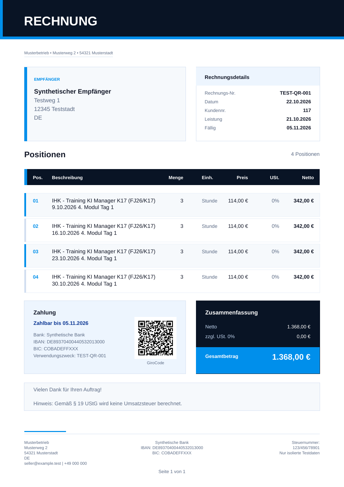

# Compact invoice notes — 2026-10-27

## Reproduction and change

The real PDFKit/font-metric regression fixture contains four two-line training
positions, quantity 3 at EUR 114 each, GiroCode and the complete small-business
tax sentence. Before the change, both the version without a custom note and the
version with a short thank-you note produced two pages (two failing regression
tests; the five existing party-layout tests passed).

Multi-line item rows now use four points less bottom padding. Font sizes and
description line spacing are unchanged. The gap after the payment/total cards
is reduced by eight points. Notes of up to three rendered lines use a compact
card without a separate heading band; the renderer reserves its actual height.
Longer notes retain their paginated heading cards. Required tax text, custom
notes, amounts, QR payload and the reserved footer boundary are retained.

Both regression variants now serialize to exactly one page. Long notes still
paginate and retain their final line and the full tax sentence. Existing issued
files and database records are untouched; preview and newly issued invoices use
the same shared renderer.

## Verification

- Six focused unit suites: **215 passed**, including eight layout tests.
- Native Linux x64 release acceptance: **13 passed**, ten positive matrix cases
  plus three rejection cases. Official pinned veraPDF **1.30.3** independently
  validated the exact final attached bytes. Preview/final page streams match;
  embedded invoice XML and the QR image/amount remain correct.
- The existing GiroCode acceptance case now exercises the four-position
  regression and explicitly requires one page; no matrix case was removed.
- `npm run lint`: passed with zero warnings. `npx tsc --noEmit`: passed.
- `npm run build`: passed, including compilation and TypeScript. Next.js emitted
  nine tracing warnings in unchanged filesystem/validator paths; the layout
  change does not resolve those separate packaging warnings.
- Poppler rendering and in-app browser visual inspection: one readable A4 page,
  complete note block and footer, no observed clipping or overlap.
- PDF tests used an explicit temporary unused database URL. Native acceptance
  ran without network access, with read-only source and no production volumes.

The first restricted production build waited during compilation and was stopped
with SIGINT; the retry with normal local Next.js worker permissions succeeded. No timeout,
test assertion, validation gate or security boundary was weakened.

Final synthetic acceptance PDF SHA-256:
`11072d7151fb489a8cf0406cbe639ac56e72e57d3b0bcf17c0c5ce6227222f53`.

Status: local, uncommitted implementation; not deployed.
